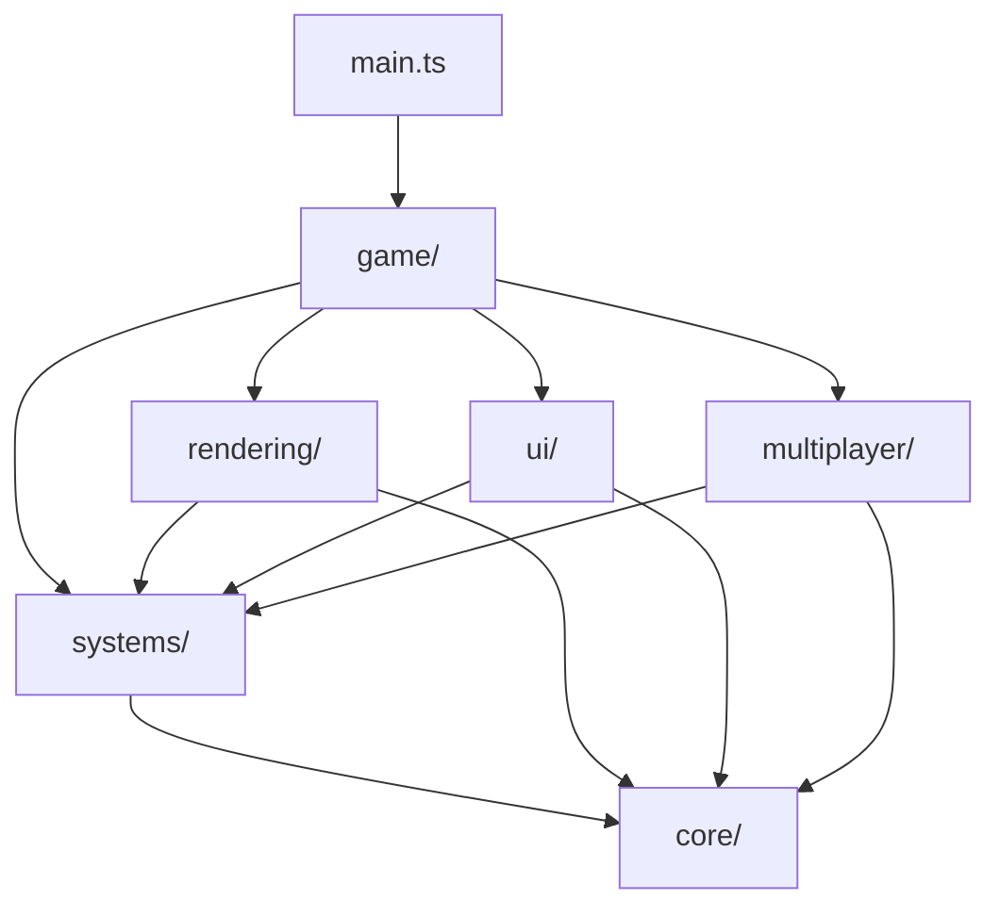

# Design Document

## Overview

This design outlines a comprehensive restructuring of the AI Snap codebase to improve maintainability, discoverability, and scalability. The restructuring organizes code into domain-based modules with clear boundaries and dependencies, while maintaining all existing functionality.

The current codebase has many systems in the root `src` directory, making it difficult to understand relationships and dependencies. This design creates a hierarchical module structure that groups related functionality and establishes clear dependency flows.

## Architecture

### Module Hierarchy

The new structure organizes code into the following hierarchy:

```
src/
├── core/              # Core infrastructure (low-level, no app dependencies)
│   ├── constants/
│   ├── utils/
│   └── types/
├── systems/           # Game systems (depend on core)
│   ├── creatures/
│   ├── terrain/
│   ├── audio/
│   ├── camera/
│   ├── photo/
│   ├── input/
│   └── state/
├── rendering/         # Rendering systems (depend on core + systems)
│   ├── scene/
│   ├── shaders/
│   ├── visual-effects/
│   └── textures/
├── ui/                # User interface (depends on core + systems)
│   ├── components/
│   ├── managers/
│   └── debug/
├── multiplayer/       # Multiplayer systems (depends on core + systems)
│   ├── webrtc/
│   ├── state-sync/
│   └── peer-avatar/
├── game/              # Game orchestration (can depend on anything)
│   ├── Game.ts
│   ├── GameLoop.ts
│   ├── SystemsCoordinator.ts
│   ├── InputHandler.ts
│   └── managers/
└── main.ts            # Entry point
```

### Dependency Flow



### Key Principles

1. **Unidirectional Dependencies**: Lower-level modules never depend on higher-level modules
2. **Domain Cohesion**: Related functionality is grouped together
3. **Minimal Public API**: Each module exposes only what's necessary through barrel exports
4. **Clear Boundaries**: Each module has a single, well-defined responsibility

## Components and Interfaces

### Core Module (`src/core/`)

**Purpose**: Provides foundational utilities, types, and constants used throughout the application.

**Structure**:
```
core/
├── constants/
│   ├── index.ts           # Barrel export
│   ├── game-config.ts     # GAME_CONFIG object
│   ├── biome-config.ts    # BIOME_COLORS, etc.
│   └── physics.ts         # TAU, HALF_PI, etc.
├── utils/
│   ├── index.ts           # Barrel export
│   ├── math.ts            # Math utilities
│   ├── pooling.ts         # Object pooling
│   └── random.ts          # RNG utilities
└── types/
    ├── index.ts           # Barrel export
    ├── common.ts          # Shared types
    └── geometry.ts        # Geometry types
```

**Public API**:
- Constants: `GAME_CONFIG`, `TAU`, `HALF_PI`, etc.
- Utils: `getPooledVector3()`, `releaseVector3()`, `memoizedSin()`, etc.
- Types: Common interfaces and type definitions

**Dependencies**: None (pure utilities)

### Systems Module (`src/systems/`)

**Purpose**: Contains core game systems that implement specific functionality domains.

**Structure**:
```
systems/
├── creatures/
│   ├── index.ts                    # Barrel export
│   ├── CreatureManager.ts          # High-level manager (from game/)
│   ├── creature-generator.ts      # Anatomy generation
│   ├── creature-builder.ts        # Mesh building
│   ├── creature-behavior.ts       # Behavior logic
│   ├── creature-pool.ts           # Pooling
│   └── types.ts                   # Creature types
├── terrain/
│   ├── index.ts                   # Barrel export
│   ├── TerrainSystem.ts           # Main terrain system
│   ├── biome-generator.ts         # Biome generation
│   └── types.ts                   # Terrain types
├── audio/
│   ├── index.ts                   # Barrel export
│   ├── AudioManager.ts            # Main audio manager
│   ├── sound-generator.ts         # Procedural sound generation
│   └── types.ts                   # Audio types
├── camera/
│   ├── index.ts                   # Barrel export
│   ├── CameraController.ts        # Camera controller
│   └── types.ts                   # Camera types
├── photo/
│   ├── index.ts                   # Barrel export
│   ├── PhotoSystem.ts             # Photo system
│   └── scoring.ts                 # Score calculation
├── input/
│   ├── index.ts                   # Barrel export
│   ├── InputManager.ts            # Input manager
│   └── types.ts                   # Input types
└── state/
    ├── index.ts                   # Barrel export
    ├── state-machine.ts           # State machine
    ├── state-integration.ts       # Integrated state manager
    ├── subsystem-state-manager.ts # Subsystem states
    ├── subsystem-states.ts        # State definitions
    └── state-sync-helpers.ts      # Sync helpers
```

**Public API**: Each system exports its main class and relevant types

**Dependencies**: `core/`

### Rendering Module (`src/rendering/`)

**Purpose**: Handles all rendering-related functionality including scene management, shaders, and visual effects.

**Structure**:
```
rendering/
├── scene/
│   ├── index.ts                   # Barrel export
│   ├── SceneManager.ts            # Main scene manager
│   ├── environment-interactions.ts # Environment interactions
│   └── park-structures.ts         # Park structures
├── shaders/
│   ├── index.ts                   # Barrel export
│   ├── ShaderManager.ts           # Shader manager
│   ├── InscryptionShader.ts       # Inscryption shader
│   └── types.ts                   # Shader types
├── visual-effects/
│   ├── index.ts                   # Barrel export
│   ├── VisualEffectsManager.ts    # Effects manager
│   ├── CRTFilter.ts               # CRT filter
│   ├── FilmGrainFilter.ts         # Film grain
│   └── ChromaticAberrationFilter.ts # Chromatic aberration
└── textures/
    ├── index.ts                   # Barrel export
    └── texture-generator.ts       # Procedural textures
```

**Public API**: Scene manager, shader manager, visual effects manager

**Dependencies**: `core/`, `systems/terrain`, `systems/audio`

### UI Module (`src/ui/`)

**Purpose**: Manages all user interface components and interactions.

**Structure**:
```
ui/
├── components/
│   ├── index.ts                   # Barrel export
│   ├── gallery.ts                 # Gallery component
│   ├── settings.ts                # Settings panel
│   ├── shortcuts.ts               # Shortcuts panel
│   ├── mini-map.ts                # Mini-map
│   └── toast.ts                   # Toast notifications
├── managers/
│   ├── index.ts                   # Barrel export
│   └── UIManager.ts               # Main UI manager
└── debug/
    ├── index.ts                   # Barrel export
    ├── DebugPanel.ts              # Debug panel
    └── ShaderDebugUI.ts           # Shader debug UI
```

**Public API**: `UIManager`, `DebugPanel`

**Dependencies**: `core/`, `systems/`, `rendering/shaders`

### Multiplayer Module (`src/multiplayer/`)

**Purpose**: Handles all multiplayer functionality including WebRTC connections and state synchronization.

**Structure**:
```
multiplayer/
├── webrtc/
│   ├── index.ts                   # Barrel export
│   ├── WebRTCPeer.ts              # WebRTC peer wrapper
│   └── ConnectionUI.ts            # Connection UI
├── state-sync/
│   ├── index.ts                   # Barrel export
│   └── StateSync.ts               # State synchronization
├── peer-avatar/
│   ├── index.ts                   # Barrel export
│   └── PeerAvatar.ts              # Peer avatar rendering
└── managers/
    ├── index.ts                   # Barrel export
    └── MultiplayerManager.ts      # Main multiplayer manager
```

**Public API**: `MultiplayerManager`

**Dependencies**: `core/`, `systems/state`, `rendering/scene`

### Game Module (`src/game/`)

**Purpose**: Orchestrates all systems and manages the game loop. This is the highest-level module.

**Structure**:
```
game/
├── Game.ts                        # Main game class
├── GameLoop.ts                    # Game loop
├── SystemsCoordinator.ts          # System initialization
├── InputHandler.ts                # Input handling
└── managers/
    ├── index.ts                   # Barrel export
    ├── CreatureManager.ts         # Creature management (stays here)
    ├── MultiplayerManager.ts      # Multiplayer management (stays here)
    └── ShaderService.ts           # Shader service (stays here)
```

**Public API**: `Game` class

**Dependencies**: All modules

## Data Models

### Module Exports Pattern

Each module follows a consistent export pattern:

```typescript
// src/systems/creatures/index.ts
export { CreatureManager } from './CreatureManager'
export { generateAnatomy, buildCreature } from './creature-generator'
export type { 
  Anatomy, 
  CreatureInstance, 
  BehaviorState 
} from './types'
```

### Path Aliases Configuration

TypeScript configuration (`tsconfig.json`):

```json
{
  "compilerOptions": {
    "paths": {
      "@core/*": ["./src/core/*"],
      "@systems/*": ["./src/systems/*"],
      "@rendering/*": ["./src/rendering/*"],
      "@ui/*": ["./src/ui/*"],
      "@multiplayer/*": ["./src/multiplayer/*"],
      "@game/*": ["./src/game/*"]
    }
  }
}
```

Vite configuration (`vite.config.ts`):

```typescript
import { defineConfig } from 'vite'
import path from 'path'

export default defineConfig({
  resolve: {
    alias: {
      '@core': path.resolve(__dirname, './src/core'),
      '@systems': path.resolve(__dirname, './src/systems'),
      '@rendering': path.resolve(__dirname, './src/rendering'),
      '@ui': path.resolve(__dirname, './src/ui'),
      '@multiplayer': path.resolve(__dirname, './src/multiplayer'),
      '@game': path.resolve(__dirname, './src/game'),
    },
  },
})
```

### Import Examples

Before restructuring:
```typescript
import { GAME_CONFIG } from './constants'
import { TerrainSystem } from './terrain-system'
import { CameraController } from './camera'
```

After restructuring:
```typescript
import { GAME_CONFIG } from '@core/constants'
import { TerrainSystem } from '@systems/terrain'
import { CameraController } from '@systems/camera'
```

## Error Handling

### Module Initialization Errors

Each module should handle initialization errors gracefully:

```typescript
export class SystemModule {
  constructor() {
    try {
      this.initialize()
    } catch (error) {
      console.error(`Failed to initialize ${this.constructor.name}:`, error)
      // Fallback to safe defaults
      this.initializeFallback()
    }
  }
}
```

### Circular Dependency Detection

The build process should fail if circular dependencies are detected. TypeScript's compiler will catch most of these, but we'll also add a custom check:

```typescript
// scripts/check-circular-deps.ts
// Run during build to detect circular dependencies
```

### Missing Module Errors

If a module fails to load, the application should:
1. Log a clear error message
2. Attempt to continue with reduced functionality
3. Display a user-friendly error message if critical

## Testing Strategy

### Unit Testing Approach

Each module should have corresponding unit tests:

```
src/systems/creatures/
├── creature-generator.ts
├── creature-generator.test.ts
├── creature-behavior.ts
└── creature-behavior.test.ts
```

### Integration Testing

Test module interactions:
- `systems/creatures` + `rendering/scene`
- `systems/camera` + `systems/input`
- `multiplayer` + `systems/state`

### Migration Testing

1. **Snapshot Testing**: Capture current behavior before restructuring
2. **Regression Testing**: Verify all features work after restructuring
3. **Performance Testing**: Ensure no performance degradation

### Test Coverage Goals

- Core utilities: 90%+ coverage
- System modules: 70%+ coverage
- Integration points: 80%+ coverage

## Migration Strategy

### Phase 1: Create New Structure

1. Create new directory structure
2. Set up barrel exports
3. Configure path aliases
4. No code moves yet

### Phase 2: Move Core Utilities

1. Move `constants.ts` → `core/constants/`
2. Move `utils.ts` → `core/utils/`
3. Move type definitions → `core/types/`
4. Update imports throughout codebase

### Phase 3: Move Systems

1. Move each system one at a time:
   - `creatures.ts` → `systems/creatures/`
   - `terrain-system.ts` → `systems/terrain/`
   - `audio.ts` → `systems/audio/`
   - etc.
2. Update imports after each move
3. Test after each move

### Phase 4: Move Rendering

1. Move `scene.ts` → `rendering/scene/`
2. Move `shaders/` → `rendering/shaders/`
3. Move `visual-effects/` → `rendering/visual-effects/`
4. Move `textures.ts` → `rendering/textures/`
5. Update imports

### Phase 5: Move UI and Multiplayer

1. Move `ui.ts` → `ui/managers/`
2. Move `debug.ts` → `ui/debug/`
3. Move `multiplayer/` → `multiplayer/`
4. Update imports

### Phase 6: Finalize

1. Update all documentation
2. Run full test suite
3. Verify build succeeds
4. Test all features manually

## Performance Considerations

### Bundle Size Impact

- **Before**: Single large bundle
- **After**: Code-split by module with tree-shaking

Expected improvements:
- Initial bundle: ~10% smaller (dead code elimination)
- Lazy-loaded modules: Better caching

### Import Performance

Path aliases have no runtime cost - they're resolved at build time.

### Module Loading

Modules are loaded synchronously at startup (no lazy loading initially). Future optimization could add dynamic imports for:
- Multiplayer module (only when needed)
- Shader debug UI (only in dev mode)
- Advanced visual effects (only when enabled)

## Documentation Updates

### Files to Update

1. `docs/structure.md` - Complete rewrite with new structure
2. `README.md` - Update import examples
3. `docs/architecture.md` - Update architecture diagrams
4. Create `docs/migration-guide.md` - Guide for developers

### New Documentation

1. `docs/modules/` - Directory with per-module documentation
2. `docs/dependency-graph.md` - Visual dependency graph
3. `docs/import-guide.md` - How to import from modules

## Rollback Plan

If issues arise during migration:

1. **Git Strategy**: Each phase is a separate commit
2. **Feature Flags**: Critical changes behind flags
3. **Parallel Branches**: Keep old structure in separate branch
4. **Incremental Rollback**: Can revert individual phases

## Success Criteria

The restructuring is successful when:

1. ✅ All existing features work identically
2. ✅ Build succeeds without errors
3. ✅ No circular dependencies
4. ✅ All imports use path aliases
5. ✅ Documentation is updated
6. ✅ Code is more discoverable (developers can find files faster)
7. ✅ Module boundaries are clear and respected
