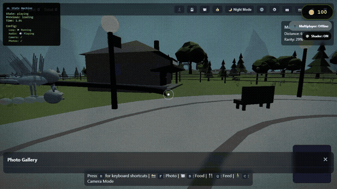
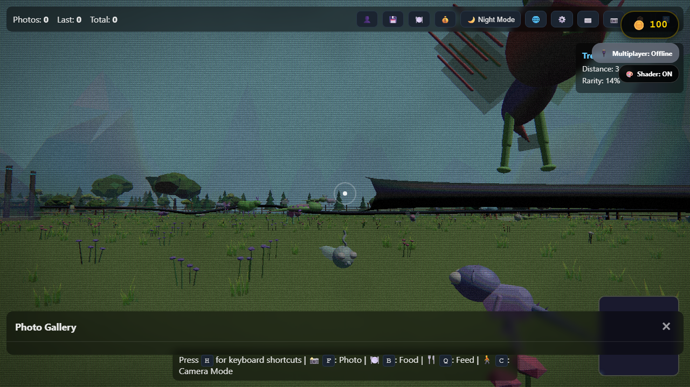
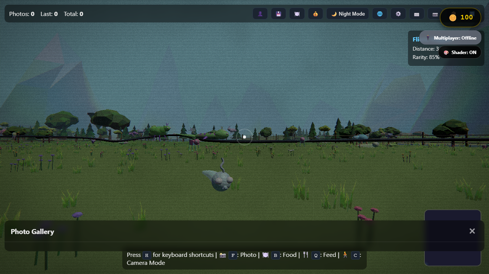
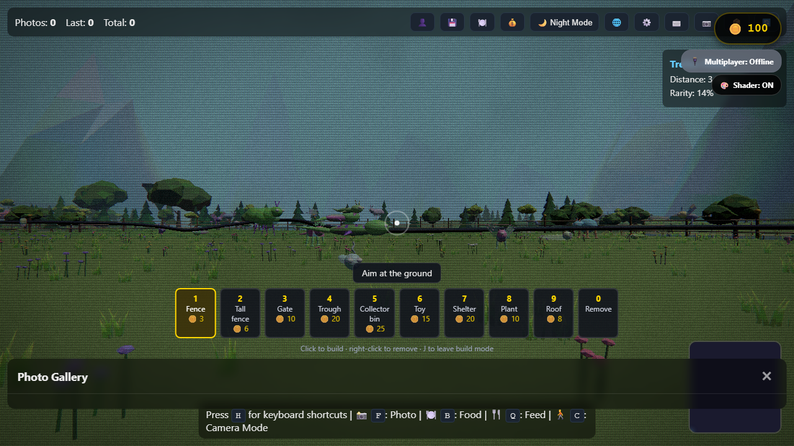
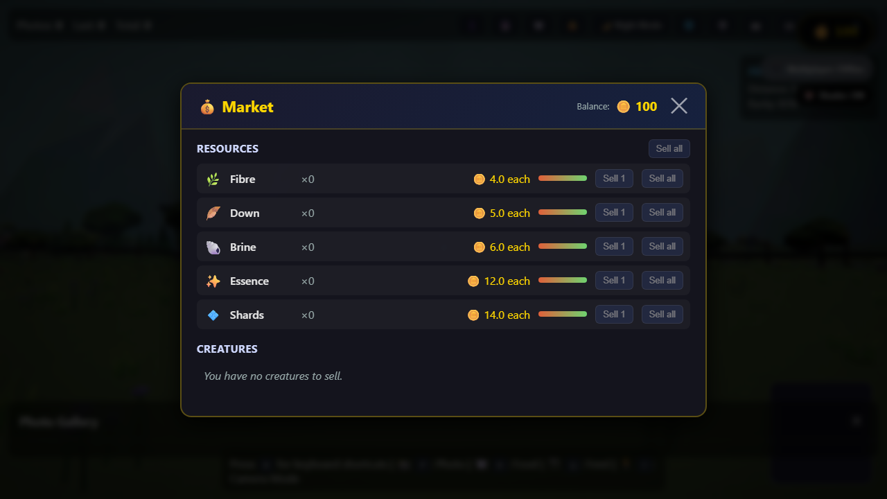
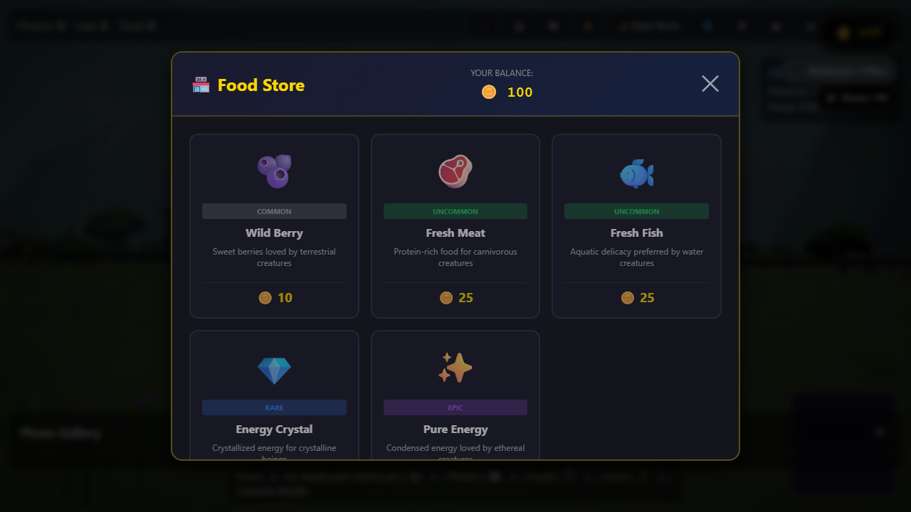
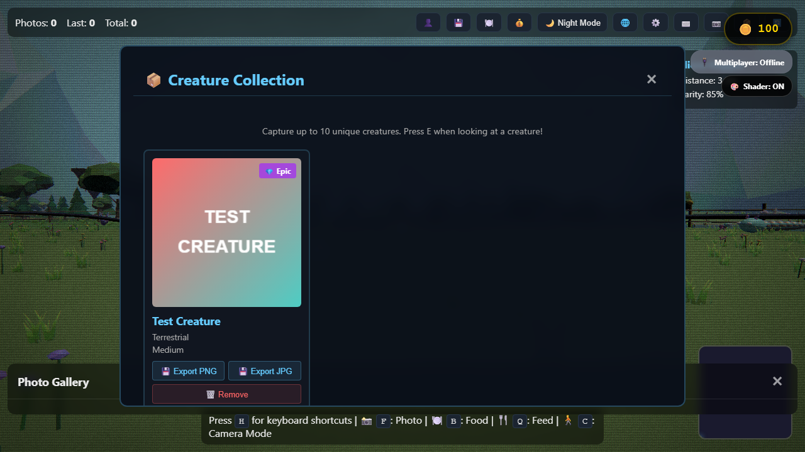

# 🦕 Procedural Park

**Run a park of impossible animals.** Find a few wild founders, breed them into stranger and rarer descendants, and build the pens, feeders and machinery that turn their appetites into income, all from first person, walking your own paddocks.


Procedural Park is a first-person creature-ranching and zoo-management game that runs in the browser. Think *Zoo Tycoon* seen from the ground, with the hands-on feed-collect-automate loop of *Slime Rancher*. Every creature is procedurally generated from a genome, so the roster is never the same twice and the breeding game never runs out of new shapes.

> Early on this project was a wildlife-photography game (working name "AI Snap"). The design has since moved to park management and breeding. Photography stays as a supporting tool. See the [Game Design Document](docs/GDD.md) for the full direction.

## 📸 Screenshots



[Full gameplay video (MP4)](docs/media/gameplay.mp4)

| | |
|---|---|
| <br>Ride through the park | <br>Free roam |
| <br>Build mode: fences, gates, troughs, bins | <br>Market: sell resources and creatures |
| <br>Food store | <br>Creature collection |

## ✨ The Idea

- **Breeding is the engine.** The big decision is which two creatures to pair and what they produce.
- **Every creature is a small business.** Archetype, size, temperament and rarity change what it eats, where it can live, what it produces and what it sells for.
- **Walk it, don't menu it.** Feeding, building, collecting and capturing happen in the world, in first person.
- **Automate the chores, keep the choices.** Progression buys machinery that removes repetition, not decisions.
- **Calm and never punishing.** Soft pressure only. Nothing kills you or is lost permanently.

## 🧩 What Works Today

The vertical slice is being built task by task (see [docs/TASKS.md](docs/TASKS.md)).

| Area | Status |
|---|---|
| Procedural creatures from a genome, with crossover for breeding | ✅ |
| Care loop: troughs, hunger, mood, hand feeding | ✅ |
| Build mode: fences, gates, troughs, collector bins, shelters, plants, roofs | ✅ |
| Pen detection and quality scoring | ✅ |
| Production: per-archetype resources, collector bins, storage | ✅ |
| Market: sell resources and creatures | ✅ |
| Capture loop: trust from feeding, lures, transport crates | ✅ |
| Biomes, day/night, retro post-processing shaders | ✅ |
| Save/load, P2P multiplayer over WebRTC | ✅ (being reworked for the new loop) |
| Hub park with residents roaming pens, Breeding Den, codex | 🔨 next |
| Automation, expeditions, trading, arena | 🗺️ later |

## 🚀 Quick Start

### Prerequisites
- Node.js 18+ and npm
- Modern browser with WebGL 2.0 support

### Installation

```bash
# Clone the repository
git clone https://github.com/idiovoidi/Procedural_Park.git
cd Procedural_Park

# Install dependencies
npm install

# Start development server
npm run dev
```

The game will open at `http://localhost:3000/Procedural_Park/`

### Building for Production

```bash
# Build optimized production bundle
npm run build

# Preview production build
npm run preview
```

## 🎮 Controls

### Camera
- **C** - Toggle camera mode (Ride/Free Roam)
- **WASD** - Move camera (Free Roam mode)
- **Mouse** - Look around (Free Roam mode)
- **Shift** - Sprint
- **Space** - Jump
- **Arrow Keys** - Look around (alternative)

### Photography
- **T** - Take photo
- **E** - Export creature card
- **G** - Toggle gallery

### Interaction
- **F** - Feed nearest creature
- **B** - Toggle food inventory
- **O** - Open food store
- **U** - Open market
- **J** - Toggle build mode
- **Y** - Crate creature
- **L** - Place lure

### UI
- **I** - Player stats
- **K** - Creature collection
- **M** - Multiplayer menu
- **H** - Keyboard shortcuts
- **Escape** - Settings menu
- **P** - Pause game

### Other
- **R** - Restart ride
- **X** - Randomize creatures
- **V** - Toggle visual effects
- **N** - Toggle day/night
- **;** - Toggle video recording (30s max)

## 📁 Project Structure

```
Procedural_Park/
├── src/
│   ├── core/                 # Core utilities and constants
│   │   ├── constants/        # Game configuration
│   │   ├── types/            # Shared TypeScript types
│   │   └── utils/            # Helper functions
│   ├── game/                 # Main game logic
│   │   ├── Game.ts           # Main game class
│   │   ├── GameLoop.ts       # Update loop
│   │   ├── SystemsCoordinator.ts  # System initialization
│   │   └── InputHandler.ts   # Input routing
│   ├── systems/              # Game systems
│   │   ├── camera/           # Camera controller
│   │   ├── creatures/        # Creature generation & AI
│   │   ├── photo/            # Photography scoring
│   │   ├── care/             # Hunger, mood, feeding
│   │   ├── park/             # Pen detection and quality
│   │   ├── build/            # First-person build mode
│   │   ├── production/       # Creature output and resources
│   │   ├── market/           # Selling resources and creatures
│   │   ├── capture/          # Trust, lures, transport crates
│   │   ├── roster/           # Owned creatures and state
│   │   ├── economy/          # Sim clock and creature stats
│   │   ├── audio/            # Audio management
│   │   ├── terrain/          # Terrain generation
│   │   ├── food/             # Feeding mechanics
│   │   ├── currency/         # Economy system
│   │   ├── input/            # Input management
│   │   └── state/            # State management
│   ├── rendering/            # Rendering systems
│   │   ├── scene/            # Scene management
│   │   ├── shaders/          # Custom shaders
│   │   └── textures/         # Texture management
│   ├── ui/                   # User interface
│   │   ├── components/       # UI components
│   │   └── managers/         # UI coordination
│   ├── multiplayer/          # Multiplayer systems
│   │   ├── webrtc/           # WebRTC implementation
│   │   ├── state-sync/       # State synchronization
│   │   └── peer-avatar/      # Peer rendering
│   └── main.ts               # Entry point
├── docs/                     # Documentation
│   ├── GDD.md                # Game design document
│   ├── TASKS.md              # Milestone task list
│   ├── CODEBASE_GOALS.md     # Code goals
│   ├── architecture.md       # Technical architecture
│   └── My_Docs/              # Development notes
├── public/                   # Static assets
├── vite.config.ts            # Vite configuration
├── tsconfig.json             # TypeScript configuration
└── package.json              # Dependencies
```

## 🏗️ Architecture

### Core Principles
- **Modular Systems**: Self-contained, loosely coupled systems
- **Event-Driven**: Systems communicate via callbacks and events
- **Configuration-Driven**: All constants in centralized config
- **Type-Safe**: TypeScript strict mode throughout

### Key Systems
- **Game Loop**: Coordinates all system updates at 60 FPS
- **State Manager**: Centralized state with flow and subsystem states
- **Input Manager**: Priority-based input handling with context awareness
- **Scene Manager**: Three.js scene graph and rendering pipeline
- **Creature Manager**: Procedural generation and behavior AI
- **Currency Manager**: Economy with transactions and rewards

See [architecture.md](docs/architecture.md) for detailed documentation.

## 🎨 Customization

### Game Configuration
Edit `src/core/constants/game-config.ts`:

```typescript
export const GAME_CONFIG = {
  CREATURE_COUNT: 60,           // Number of creatures
  WORLD_SEED: 1337,             // Procedural generation seed
  CAMERA_SPEED_DEFAULT: 0.025,  // Camera movement speed
  PHOTO_SCORE_EXCELLENT: 80,    // Score threshold
  // ... more settings
}
```

### Adding New Creatures
1. Define anatomy in `src/systems/creatures/creature-generator.ts`
2. Add behavior patterns in `src/systems/creatures/creature-behaviour.ts`
3. Configure rarity in creature generation logic

### Creating New Food Items
1. Add to `src/systems/food/food-data.ts`:
```typescript
export const FOOD_ITEMS = {
  newFood: {
    id: 'newFood',
    name: 'New Food',
    icon: '🍎',
    effectiveness: { /* archetype preferences */ },
    // ...
  }
}
```
2. Add to store in `src/systems/food/store-data.ts`

## 🧪 Development

### Available Scripts

```bash
npm run dev          # Start development server with HMR
npm run build        # Build for production
npm run preview      # Preview production build
npm run type-check   # Run TypeScript type checking
npm run check        # Biome lint + format check
npm test             # Run unit tests (Vitest)
npm run test:watch   # Re-run tests on change
npm run lint         # Lint TypeScript files
npm run lint:fix     # Auto-fix linting issues
npm run format       # Format code with Biome
```

### Debug Tools
- **F12**: Toggle debug panel (FPS, memory, system status)
- **Console**: System events and detailed logging
- **State Panel**: View state machine transitions (dev mode)

### Performance Tips
- Use object pools for frequently created objects
- Leverage memoization for expensive calculations
- Monitor debug panel for performance bottlenecks
- Enable auto-performance adjustment in shader settings

### Testing

Unit tests use [Vitest](https://vitest.dev) and live next to the code as `*.test.ts`
(for example `src/systems/currency/CurrencyManager.test.ts`). Tests run in Node;
`tests/setup.ts` stubs `localStorage` and `window` timers and silences the logger.
Aim tests at pure logic (state, economy, serialization, seeded generation) rather than
Three.js rendering. Shared Vitest settings, including the path aliases, are in `vitest.config.ts`.

## 🤝 Contributing

Contributions are welcome! Please follow these guidelines:

1. **Fork the repository**
2. **Create a feature branch**: `git checkout -b feature/amazing-feature`
3. **Follow code style**: Use existing patterns and naming conventions
4. **Test thoroughly**: Manual testing in development mode
5. **Update documentation**: Add/update relevant docs
6. **Commit changes**: `git commit -m 'Add amazing feature'`
7. **Push to branch**: `git push origin feature/amazing-feature`
8. **Open a Pull Request**

See [CODEBASE_GOALS.md](docs/CODEBASE_GOALS.md) for detailed contribution guidelines.

## 📝 Roadmap

Milestones from the [GDD](docs/GDD.md):

- **M1 Vertical slice (in progress):** capture a founder, pen it, earn from it, breed a child, hatch it and sell it in about 30 minutes.
- **M2 Automation:** feeders, conveyors, silos, auto-sell, contract board.
- **M3 Expeditions:** multiple maps, study and special-condition captures, night spawns.
- **M4 Social:** card trading, friend park visits, shared codex.
- **M5-M6 Depth and arena:** pedigree, mutations, staff, deterministic auto-battler.
- **M7 Platform polish:** gamepad, mobile touch, performance scaling, accessibility.

## 🐛 Known Issues

- WebRTC multiplayer may have connection issues on some networks
- Safari has limited WebRTC support
- Performance may vary on older hardware

## 📄 License

MIT.

## 🙏 Acknowledgments

- **Three.js** - 3D graphics library
- **Vite** - Build tool and dev server
- **simple-peer** - WebRTC wrapper
- **postprocessing** - Visual effects pipeline

## 📧 Contact

- **Issues**: [GitHub Issues](https://github.com/idiovoidi/Procedural_Park/issues)

---

Made with ❤️ and TypeScript
