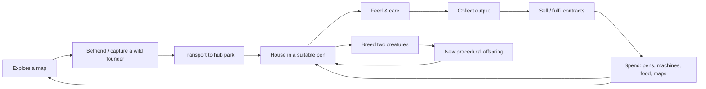

# Procedural Park — Game Design Document

| | |
|---|---|
| **Status** | Draft v0.1 — design direction agreed, numbers are starting values for playtesting |
| **Working title** | Procedural Park (repo/package name: `ai-snap`) |
| **Genre** | First-person creature-ranching / zoo-management tycoon with procedural breeding |
| **Platform** | Web (WebGL 2): desktop keyboard + mouse, gamepad, mobile touch |
| **Tone** | Retro, moody, calm — long, low-pressure sessions |
| **Reading guide** | ✅ = exists in the codebase today · 🔨 = in the code but needs rework · 🆕 = new, proposed here |

---

## 1. Vision

> **You run a park of impossible animals. You find a few wild founders, then breed them into stranger, rarer, more valuable descendants — and build the pens, feeders and machinery that turn their appetites into income.**

Think *Zoo Tycoon* and *Jurassic Park: Operations* — the pride of a thriving park and the pleasure of a growing roster — seen from **first person**, walking your own paddocks. Think *Slime Rancher* for the hands-on loop of feeding, collecting output and automating chores. Every creature is **procedurally generated**, so the roster is never the same twice and the breeding game never runs out of new shapes.

### 1.1 Design pillars

1. **Breeding is the engine.** The most interesting decisions are *which two creatures to pair* and *what that produces*. Everything else (pens, food, machines, maps) exists to feed, house and monetise that choice.
2. **Every creature is a small business.** Anatomy, size, temperament, archetype and rarity all change what a creature eats, where it can live, what it produces and what it is worth. No creature is cosmetic.
3. **Walk it, don't menu it.** Feeding, building, collecting, inspecting and breeding happen in the world, in first person. Menus summarise; they don't replace.
4. **Automate the chores, keep the choices.** Early play is hands-on; progression buys machinery that removes repetition while leaving the breeding and layout decisions to the player.
5. **Calm, moody, never punishing.** Soft pressure only: skittish creatures, an eerier night, shortages. Nothing kills the player or ends a session, and nothing is lost permanently.

### 1.2 What the game is *not*

- Not primarily a photography game. Photography stays as a supporting tool (§9).
- Not a combat game. Auto-battling is a late, optional layer (§11).
- Not a server-run MMO. It ships as a static site; sharing is peer-to-peer and file-based (§12).

### 1.3 Audience and session shape

Players who like management/idle-adjacent games, creature collectors and "one more breed" loops. Sessions are **30+ minutes** and open-ended; the game should be comfortable to leave running and easy to resume (§13.4).

---

## 2. Core loop



| Loop | Cadence | Player verbs |
|---|---|---|
| **Moment** | seconds | walk, feed, collect output, inspect, place |
| **Cycle** | 2–5 min | refill/route food, empty storage, sell, queue a breeding |
| **Session** | 30–90 min | hatch offspring, expand a pen, unlock/automate a facility, complete a contract |
| **Meta** | many sessions | unlock new maps and species pools, specialise the park, chase rare lineages, trade with friends |

**The key tension** the economy must keep alive: rare, high-value creatures are *harder to keep* (pickier diet, special habitat, incompatible temperaments), so greed has a real cost and a skilled layout beats a rich one.

---

## 3. The player

- **Perspective:** first-person, free movement (WASD / left stick / touch stick), mouse/right-stick look. ✅ Free-roam camera exists.
- **Tool belt** 🆕: one active tool at a time, cycled with number keys / shoulder buttons / radial menu.

| Tool | Does | Status |
|---|---|---|
| **Hands** | Collect output, pick up crates/items, interact with machines | 🆕 |
| **Feed** | Throw/offer selected food to the nearest creature (within 15 m, 5 s per-creature cooldown) | ✅ (`Q`) |
| **Scanner / Camera** | Inspect a creature, study species, take photos | ✅ photo system / 🔨 repurposed |
| **Build** | Place pens, fences, feeders, collectors, decorations with ghost preview and snapping | 🆕 |
| **Lure / Crate** | Place bait, set traps, deploy transport crates (expeditions) | 🆕 |

- **Ride mode** ✅ (automated path camera) is repurposed as the **park tram**: a relaxing tour of the hub and the transit between hub and expedition maps. It also stays useful as an idle "screensaver" view.
- **Soft pressure only:** the player has no health. Stamina/sprint ✅ exists and may gate expedition pacing, but never causes failure.

---

## 4. Creatures

Creatures are the heart of the game and the code already has a solid base: a JSON-safe **genome** ✅ (`src/systems/creatures/genome/`) that deterministically builds a mesh, plus a working **`crossover()`** ✅ (`breed.ts`) that blends two genomes.

### 4.1 What a creature is (existing data)

| Genome field | Meaning today | Used by the economy (🆕) |
|---|---|---|
| `archetype` (terrestrial, aerial, aquatic, ethereal, crystalline) | Visual theme + food preferences | **Diet, habitat type, and which resource it produces** |
| `bodyPlan` (quadruped, biped, hexapod, serpent, winged_biped, swimmer, floater, cluster) & `locomotion` (walk, slither, swim, fly, drift, hover) | Silhouette and movement | **Pen requirements** (height for fliers, water for swimmers, open floor for walkers) |
| `size` (tiny → huge) | Scale | **Space required, food consumed, output volume** |
| `temperament` (shy, curious, aggressive, playful, territorial) | Behaviour state machine | **Pen compatibility, care difficulty, output bonuses** |
| `rarity` (0..1 float) | Optional features, glow | **Value multiplier, pickiness, unlock gating** |
| `genes` (girth, length, head, eye, limb, tail, wing, glow) | Continuous proportions | Cosmetic **and** inherited trait strength |
| `palette`, `pattern` | Colour + surface | **Collector premium** and contract matching |
| `limbSets`, `wings`, `tails`, `antennae`, `ears`, `horns`, `spines`, `furTufts`, `scales` | Optional parts | **Contract traits** now; **combat stats** later (§11) |

`speciesId` is computed from the genome and `species-name.ts` generates names, so **a new combination can become a new, named species** — a built-in "discovery" moment.

#### Derived stat rules (implemented in `src/systems/economy/creature-economy.ts`)

| Need | Rule |
|---|---|
| **Resource** | archetype → resource: terrestrial fibre, aerial down, aquatic brine, ethereal essence, crystalline shards (names are placeholders) |
| **Floor area** | by size: tiny 4 · small 6 · medium 10 · large 20 · huge 32 m² |
| **Water** | `swim` locomotion or `swimmer` body plan → deep; other aquatic creatures → shallow; everyone else none |
| **Enclosure** | `fly` → roofed aviary; `hover`/`drift` → tall; all others → ordinary fence |
| **Enrichment** | playful → high; curious → medium; shy/aggressive/territorial → low |
| **Preferred scenery** | by archetype (e.g. aquatic → wetland; crystalline → crystal cave, rocky) |
| **Diet efficiency** | the food table's archetype effectiveness, raised to the power `1 + 0.25 × rarityTierIndex` — a perfect match always stays 100%, a poor match hurts more as rarity rises |
| **Food use** | medium creature eats 1 serving per cycle × size multiplier ÷ diet efficiency (efficiency floored at 10%) |
| **Pen sharing** | aggressive never shares; territorial only with its own species; shy/curious/playful mix freely |
| **Value** | rarity tier multiplier (common 1× … legendary 7×), tiers start at rarity 0 / 0.4 / 0.6 / 0.8 / 0.92 |

### 4.2 Founders vs. bred creatures

- **Founders** come from `generateGenome(seed)`: fully reproducible from a seed.
- **Bred creatures** come from `crossover(a, b, seed)`: deterministic given the parents and seed, but **not reproducible from their own seed alone** — their full genome must be stored (as `breed.ts` already warns). The save format and card format therefore store genomes, not seeds (§13.3).

### 4.3 Individual state (🆕)

| Stat | Range | Drives |
|---|---|---|
| **Hunger** | 0–100 | Production stops when empty; never kills |
| **Happiness** | 0–100 | Output multiplier; low → skittish, no breeding |
| **Trust** | 0–100 | Handling ease, capture, breeding willingness. ✅ food already grants trust/happiness |
| **Age stage** | hatchling → juvenile → adult (no elder stage or lifespan, §17.1 Q4) | Output, breeding eligibility, size scaling |
| **Lineage** | parent ids, generation | Pedigree display, optional inbreeding rules (§6.5) |

> **Rule of thumb:** a creature should be *legible at a glance* — its body tells you what it eats and where it lives (a floater hovers, a swimmer needs water), and its colour and glow tell you roughly what it's worth.

---

## 5. Park management

### 5.1 The hub park

The **hub** is the player's home: a walkable, build-able park, procedurally laid out and seeded per save. The terrain system ✅ already produces a flat, fenced area inside hills and ponds outside; the hub keeps that flat interior as the **build zone** and grows it through land-expansion purchases.

### 5.2 Pens (habitats)

A **pen** is an enclosed region with a **habitat profile**: ground/biome type, water, vegetation, height and area. Creatures are happiest when the pen matches their needs.

| Requirement | Derived from | Example |
|---|---|---|
| **Area per creature** | `size` | Huge = 8× tiny |
| **Habitat type** | `archetype` / `bodyPlan` | Aquatic needs a pond tile %, crystalline needs cave-rock tiles |
| **Height / enclosure** | `locomotion` | Fliers need a roofed or tall-fenced aviary; swimmers need depth |
| **Diet** | `archetype` (food matrix, §5.4) | Fed by hand, feeder, or conveyor |
| **Company** | `temperament` | Aggressive/territorial: 1 per pen or compatible groups only |
| **Enrichment** | `temperament`, `rarity` | Playful creatures want toys; curious want props |

**Pen quality** is a 0–1 score from the above; it multiplies happiness and therefore output. Players learn to read a *pen panel* (green/amber/red per requirement) rather than guess.

### 5.3 Care model

Each production cycle a creature consumes food proportional to size. If its pen quality and hunger are good, it produces output; if not, it simply produces less and gets skittish. **No creature dies, escapes permanently, or is taken away** — failure costs time and income only (pillar 5).

### 5.4 Food ✅ / 🔨

The food system exists and maps directly onto the economy.

| Food | Price today | Best for | Effect today |
|---|---|---|---|
| Wild Berry | 10 | Terrestrial | +10 happiness, +5 trust |
| Fresh Meat | 25 | Terrestrial / Aerial | +15 / +10 |
| Fresh Fish | 25 | Aquatic | +15 / +10 |
| Energy Crystal | 50 | Crystalline | +20 / +15 |
| Pure Energy | 100 | Ethereal | +25 / +20 |

The existing **effectiveness matrix** (archetype × food, 10–100%) becomes the **diet efficiency** — feeding the "wrong" food still works but wastes food and yields less. 🆕 Foods become **producible** (berry bushes, fish ponds, crystal seams) so the player can feed the park from its own economy, which is the seed of the automation game.

### 5.5 Guests (optional, later)

*Zoo Tycoon* earns from visitors; this design earns from **creature output and creature sales**. A visitor layer (ticket income, park rating, guest happiness) is **deliberately deferred** — see Open Questions §17. If added, it would reward *variety and rarity on display*, giving showy pens a purpose beyond production.

---

## 6. Breeding

Breeding is the central activity and the main source of long-term progression and income growth.

### 6.1 Flow

1. Build a **Breeding Den** 🆕 (facility, upgradable).
2. Place **two adult, happy creatures** in it (same pen or compatible archetypes).
3. Pay the **breeding cost** (food + coins) and start a timer. A cooldown prevents spam.
4. After the timer, an **egg/offspring** appears. Genome = `crossover(parentA, parentB, seed)` ✅.
5. The offspring hatches into the world as a **hatchling**, is named by `species-name.ts` ✅, and is recorded in the **Codex** (new species flagged "Discovery!").

### 6.2 What crossover already does

From `breed.ts` ✅: the child keeps **one parent's body** (plan, torso, limbs, head) so silhouettes stay coherent; **part groups** (wings, tails, horns, etc.) come from either parent where the child's body can carry them; **genes and colours blend** (hue averaged correctly around the colour wheel); **rarity** is the parents' average with ±jitter, and `glow` derives from rarity. Same parents + seed always give the same child.

### 6.3 Making breeding a *decision*

For breeding to be a game rather than a lottery, outcomes must be **predictable enough to plan, surprising enough to excite**:

- **Combiner preview** 🆕: before committing, the player sees a *range* — a few seeded previews plus a trait odds panel ("body: 50% A / 50% B", "wings: likely", "rarity ≈ 0.6 ± 0.05"). Building on this, the combiner idea from the backlog becomes the Den's preview UI.
- **Pairing rules** 🆕: breeding is limited by size class (±1 step), compatible body plans, and adult age — so the player must *engineer* compatible lineages instead of mashing any two.
- **Selective pressure** 🆕: **contracts** (§7.3) ask for specific traits, so the player *aims* at a trait set across generations.

### 6.4 Rarity ladder

| Rarity float | Tier | Typical features | Value × |
|---|---|---|---|
| 0.00–0.40 | Common | Few optional parts | 1.0 |
| 0.40–0.60 | Uncommon | + parts | 1.6 |
| 0.60–0.80 | Rare | + decor, richer palettes | 2.5 |
| 0.80–0.92 | Epic | + glow starts (>0.75) | 4.0 |
| 0.92–1.00 | Legendary | Full glow, signature features | 7.0 |

*(Tier names and discovery rewards already exist in `currency-rewards.ts`; multipliers are new and tunable.)* Higher tiers are **pickier** — a legendary needs a premium diet and an ideal pen — so value is never free.

### 6.5 Depth to add later (not in the vertical slice)

- **Lineage tracking and pedigree view.**
- **Inbreeding penalty** (reduced happiness/fertility for close relatives) to force outcrossing with wild founders and trading.
- **Mutation events** (small chance of a new part or colour not in either parent).
- **Dominant/recessive traits** — a deliberate *later* system; the first design uses simple blending.

---

## 7. Economy

### 7.1 Currency

**Safari Coins** ✅ (`CurrencyManager`, starting balance 100, persisted). Coins are the universal sink/source; resources are the intermediate good.

### 7.2 Income sources

| Source | Description | Phase |
|---|---|---|
| **Resource production** 🆕 | Each creature yields a resource per cycle (§7.4); sold at the market | Slice |
| **Creature sales** 🆕 | Sell surplus or showpiece creatures; price from rarity, traits, age, lineage | Slice |
| **Contracts** 🆕 | Buyers request specific traits/sizes/species for a bonus | Slice |
| **Study/discovery bonuses** ✅ | Existing discovery rewards, photo rewards (5–50), feeding rewards | Slice (reduced) |
| **Guests/tickets** | Visitor income | Later (open question) |

### 7.3 Contracts 🆕

A rotating **Contract Board** posts requests such as *"Large, winged, blue, glowing — 600 coins"* or *"3 aquatic juveniles for a reserve — 400"*. Contracts are the **bridge between breeding and income**: they give the player a target to breed toward and a reason to keep diverse lineages. Seeded generation keeps them reproducible; difficulty scales with unlocked maps.

### 7.4 Resources 🆕

Each archetype produces a distinct resource. Names are **placeholders**.

| Archetype | Resource | Used for |
|---|---|---|
| Terrestrial | **Fibre / Hide** | Basic building materials, fertiliser (grows berries) |
| Aerial | **Down / Feathers** | Decor, aviary upgrades |
| Aquatic | **Brine / Pearls** | Water facilities, luxury sale |
| Ethereal | **Essence** | High-tier upgrades, enchanting facilities |
| Crystalline | **Shards** | Advanced machines, premium sale |

### 7.5 Output formula (starting point)

```
outputPerCycle = base(archetype)
               × sizeMult(size)          // tiny 0.5 … huge 2.0
               × rarityMult(rarity)      // see §6.4
               × happinessMult(0..1)     // 0.25 … 1.25, driven by pen quality + food
               × temperamentBonus        // e.g. playful +10% with enrichment, shy -10% when watched
               × ageMult(stage)
foodPerCycle   = baseFood × sizeMult × dietEfficiency⁻¹
```

Target ratio for the slice: **a well-kept common creature roughly pays for its own food plus a small profit; rarity and size scale profit faster than they scale cost** — *until* the pickiness penalty makes rare creatures harder to keep well. All constants live in `GAME_CONFIG` (the project's existing "no magic numbers" rule ✅).

### 7.6 Sinks (so coins matter)

Pens and fences, expansion land, food and seeds, machines and upgrades, breeding costs, decoration, expedition supplies (crates, bait), map unlocks. Keep **at least two always-useful sinks** at every stage so the player never feels the economy has "run out".

### 7.7 Balance guard-rails

- No infinite loop: any production chain must lose value to a **sink or friction** somewhere (decay, upkeep, cap).
- Selling price drops for **saturated** resources (market demand) to push diversification.
- **Soft cap** on active creatures per pen and per park tier to bound performance and avoid pure scale-out strategies.

---

## 8. Facilities and automation

The *Slime Rancher* hook: start by hand-feeding and hand-collecting; progression turns that into a **machine you tune**.

| Tier | Unlock | Facilities | Replaces manual task |
|---|---|---|---|
| **1 — Hands-on** | Start | Basic pen, trough, market stall | — |
| **2 — Assist** | Early | **Feeder hopper** (per-pen, holds N servings), **collector bin** (stores output), market cart | Refilling single feedings; carrying small output |
| **3 — Logistics** | Mid | **Range-based** food silo and resource silo, **auto-sell** valve with price floor (conveyors/pipes are an optional later tier, see §17.1 Q8) | Carrying food between sites; manual selling |
| **4 — Production** | Mid–late | **Food farms** (berry, fish, crystal, essence generators), processors that combine resources | Buying all food from the store |
| **5 — Staff** | Late | **Keepers** (NPC workers assigned to pens), **Breeders' assistant** (queues breeding to a target trait) | Routine care and queueing |

**Upgrade principle:** upgrades change **capacity, range, speed, or automation level**, not just flat numbers, so each purchase also changes *how the park is laid out and walked*.

**Never automate the choice:** breeding pairings, contract picks and layout stay manual; the game should always leave the player something meaningful to do while automation runs.

---

## 9. Photography, study and the Codex

Photography was the original pillar; it becomes a **supporting system** that is cheap to keep and still pays off:

| Use | How |
|---|---|
| **Study** | Photographing a wild species reveals its diet, habitat needs and temperament in the Codex — reducing trial and error before capture |
| **Show value** | A high-scoring "show photo" can unlock a one-time premium on a creature's sale price (marketing shot) |
| **Contracts** | Some contracts require a photo proof (e.g. a rare creature mid-pose) |
| **Cards** | Creature cards ✅ — PNG with embedded metadata that reconstructs the creature — are the **save/share/trade format** (§12) |

The existing photo scoring (distance 40%, framing 40%, rarity 20%) ✅ and gallery ✅ stay as-is. Photo currency rewards are **reduced** so photos supplement, not replace, the breeding economy.

**Codex** 🔨 (already planned in backlog): lists every species found or bred, with a silhouette until *studied*; tracks the best individual of each; flags "Discovery!" on new bred species.

---

## 10. World, maps and capture

### 10.1 Map structure

**Hub plus separate maps** (as agreed). A **map manager** 🆕 loads and swaps maps (the backlog already specifies one and a `maps/` folder).

| Map | Role | Biomes (✅ in terrain system) |
|---|---|---|
| **Hub Park** | Home, building, breeding | Fenced flat meadow ringed by hills |
| **Expedition maps** | Find and capture wild founders | forest, meadow, rocky, wetland, crystal cave, floating islands — each themed with its own species pool and archetype leanings |

New maps unlock via **progression** (park tier / coins / codex milestones). Each map is seeded, so a **shared seed reproduces the same map and wild founders** for friends.

### 10.2 Capture methods

Capture isn't one mechanic — it's a **toolbox** the player can mix, and the set will expand as the game is built. Initial set (agreed):

| Method | How it works | Best for |
|---|---|---|
| **Feeding & trust** ✅ foundation | Right food builds trust; at full trust the creature accepts a crate | Docile and common creatures |
| **Lure & enclose** 🆕 | Bait draws creatures into a trap/pen on the map | Shy or skittish species |
| **Photographic study** 🆕 | Enough study of a species unlocks tamer behaviour/summon | Rare or cautious species |
| **Special conditions** 🆕 | Time of day, weather, biome event or item needed | Epic/legendary founders |

Capture always ends in a **transport crate** that delivers the creature to the hub, with a short travel/delivery step.

### 10.3 Soft pressure on expeditions

Creatures can **flee** or turn skittish; **night** is eerier and spawns rarer, harder-to-trust species; crates have a **limited carrying capacity**. Failing costs bait/time. The player is never harmed, and a flee-and-return loop is fine.

---

## 11. Auto-battler (late-game layer)

**Optional, never required for progression.** Included here so the genome and data model don't block it.

- **Derived combat stats**, no separate RNG: size → HP, limbs → attack count, horns/spines/tails/wings → special moves, temperament → behaviour (aggressive charges, shy retreats, playful baits), archetype → type matchups. The genome already contains every input.
- **Arena facility** in the hub: set a team, a formation and let a **deterministic seeded simulation** resolve the fight (important for fair friend duels over P2P).
- **Rewards:** cosmetic and currency rewards, **no permadeath**. Victory should reward *breeding for traits*, tying the layer back to the core engine.
- **Friend duels:** exchange team genomes (cards) and run the same seeded sim on both sides; compare results.
- **Risk:** battle meta could push players to breed only for combat. Guard: combat stats come from **the same traits that matter for the economy**, so the best fighter is rarely the best earner.

---

## 12. Multiplayer

Direction (agreed): **light co-op first**, grow as the core game matures.

### 12.1 Today ✅

Serverless **WebRTC peer-to-peer** with manual offer/answer code swap, a status pill, ping latency, a cyan peer avatar with a view cone, photo-event notifications. The two-browser end-to-end test covers the handshake, position sync, event relay and disconnect.

### 12.2 Phased plan

| Phase | Feature | Notes |
|---|---|---|
| **MP-0** ✅ | Shared-presence exploration | Current state |
| **MP-1** | **Card trading** | Send a creature card; receiver imports the genome into their roster. File- and code-based, no server needed |
| **MP-2** | **Visit a friend's hub** | Host streams a read-only park snapshot; the guest walks through and photographs |
| **MP-3** | **Shared codex** | Species either player has found are logged for both during a session |
| **MP-4** | **Joint breeding** | Each player brings one parent to a shared Den; each receives an offspring |
| **MP-5** | **Friend duels** | Deterministic auto-battle (§11) |

### 12.3 Known issues

- ~~The host's 30 s connection timeout started when the offer was generated, so it included the human copy/paste time.~~ **Fixed (T1):** a 5-minute `signalingTimeout` covers the manual code exchange, and the 30 s `connectionTimeout` starts only once the answer is applied.
- ~~A deliberate Disconnect was reported as a "Multiplayer error".~~ **Fixed (T1):** Chrome's data-channel close error is now treated as a normal disconnect on both sides.
- Consider a **lightweight signalling option** (optional, later) for room codes instead of manual blobs, without making a server mandatory.

---

## 13. Technical design

### 13.1 Mapping design to the existing architecture

The project's principles ✅ — modular self-contained systems, event-driven communication, config in `GAME_CONFIG`, object pooling, seeded RNG — fit this design directly.

| New system 🆕 | Location (proposed) | Builds on |
|---|---|---|
| **Park / Pens** — enclosure detection, habitat profile, quality score | `src/systems/park/` | terrain tiles ✅, creature behaviour ✅ |
| **Care** — hunger/happiness/trust ticking | `src/systems/care/` | `FoodManager` ✅ |
| **Production** — per-cycle output, storage | `src/systems/production/` | `CurrencyManager` ✅ |
| **Breeding** — Den, pairing rules, preview, timers | `src/systems/breeding/` | `genome/breed.ts` ✅ (`crossover`) |
| **Contracts / Market** — board, pricing, demand | `src/systems/market/` | `currency-rewards.ts` ✅ |
| **Facilities & Automation** — feeders, conveyors, silos | `src/systems/facilities/` | placement + pools |
| **Maps** — map manager, per-map seed and species pool | `src/game/maps/` | `TerrainSystem` ✅, `WorldStateManager` ✅ |
| **Codex / Roster** | `src/systems/codex/` | creature cards ✅, collection UI ✅ |
| **Build mode** — ghost placement, snapping, radial menu | `src/systems/build/` | input manager ✅ |

Each new system follows the existing pattern: a manager class, typed state in the **subsystem state manager** ✅ (state machine + `onSubsystemChange`), config in `GAME_CONFIG`, a barrel `index.ts`, and **vitest unit tests** ✅ (the repo already runs them in CI).

### 13.2 Simulation model

- **Fixed-step economy tick** (e.g. 1 tick = 1 simulated second) separate from rendering, so the economy is **deterministic and testable** without WebGL.
- Creatures far from the player run a **cheap, abstract** simulation (needs + production only); only nearby creatures run full behaviour AI and animation. The existing creature pool ✅ is the base for this.
- **Offline catch-up** 🆕: on load, compute elapsed time since last save and apply production in bulk with a **cap** (e.g. 8 h) and storage limits, so long-session players aren't punished for closing the tab and idle farming can't be exploited. In-progress breeding timers complete during the gap, but new breeding can't be queued offline (§17.1 Q6).

### 13.3 Data and persistence

- **Local save** in browser storage ✅ (the game already saves via `WorldStateManager` and uses localStorage for the collection). Extend it with: roster, pens, facility graph, inventory, codex, contracts, map seeds, and the **clock**.
- **Versioned saves with migrations** 🆕 — add a `saveVersion` and write explicit migrations. The genome already has `version: 1` ✅ and `validate.ts` ✅, which is the model to follow.
- **Store full genomes** for bred creatures (not seeds) — see §4.2.
- **Cards** ✅ are the export/trade/share format: PNG + embedded metadata containing the genome (and, for pedigrees, parent genome ids). Import validates with `validate.ts`.
- **Save export/import** 🆕 as a plain file for backup — with no server, this is the only protection against cleared browser data.

### 13.4 Performance and platform budgets

- **Draw calls:** instance repeated parts (trees/rocks already scattered via instancing ✅); share geometry/material per body-part family.
- **Creature cap in view** and LOD (swap detailed anatomy for simple proxies at distance).
- **Mobile target:** 30 fps on mid-range phones with reduced shader/post-processing, smaller viewport, lower creature cap and shorter draw distance. The retro post-processing stack (CRT, grain, chromatic aberration) ✅ must be **optional/scalable** — a quality setting, not a hard dependency.
- **Input:** extend the existing `InputManager` ✅ with a **gamepad layer** and **touch controls** (virtual sticks, tap-to-interact, a bottom tool bar) mapped to the same action set so game code never checks device types.

### 13.5 Testing strategy

- **Unit tests** for the economy (output formulas, diet efficiency, pen-quality scoring), breeding (determinism, trait inheritance, pairing rules), contract generation, and save migration.
- **Balance simulation script** 🆕: run a bot park for N simulated hours to catch runaway income or dead-end economies before playtesting.
- **E2E** (Playwright ✅): extend the two-browser suite to card trading (MP-1) and friend park visits (MP-2) as they land.
- Deploy pipeline ✅ runs check → type-check → test → build before publishing to GitHub Pages.

---

## 14. Art, audio and UX direction

### 14.1 Visual identity — retro, moody

- Low-poly procedural creatures with palette-driven colour ✅; strong silhouettes; emissive glow reserved for high rarity.
- The shader/post stack ✅ (CRT scanlines, film grain, chromatic aberration, pixel-art options) defines the look — treat it as the **default**, with a **clean mode** for accessibility and low-end devices.
- A **day/night cycle** ✅ (toggle exists) becomes a gameplay-relevant mood layer: calm warm days, eerier cooler nights with rarer creatures.

### 14.2 Audio

Ambient layered soundscapes per biome, soft mechanical hum for facilities, distinct vocal "voices" per archetype, a gentle musical sting for **discoveries** and **hatchings**. The audio system ✅ (sound effects, UI clicks, camera shutter) is the foundation.

### 14.3 HUD and UX principles

- **Minimal HUD:** coins, active tool, a small notification feed, crosshair ✅ with a context prompt ("Feed", "Collect", "Inspect").
- **Diegetic information first:** creatures show mood via animation/particles; pens show quality with colour-coded signage; machines show state with lights.
- **Panels on demand:** Roster, Codex, Contracts, Market, Pen panel, Den preview — all accessible by hotkey/menu and from in-world interaction.
- **Clear feedback for every sale, hatch and unlock**, with sound and a brief on-screen celebration.
- **Accessibility:** rebindable keys, colour-blind-safe pen indicators (shape + colour), text scaling, an option to disable flicker/CRT effects.

---

## 15. Progression and milestones

### 15.1 Player progression

| Stage | Park tier | Unlocks |
|---|---|---|
| **1 — Settler** | Tiny hub | First pen, trough, market stall; first wild founders from the starter map |
| **2 — Keeper** | Small | Feeder hopper, collector bin, Breeding Den, contracts, second map |
| **3 — Curator** | Medium | Silos, auto-sell, food farms, three more maps, Codex milestones |
| **4 — Director** | Large | Staff, advanced machines, legendary-tier species, arena (battles) |
| **5 — Legend** | Max | Prestige/cosmetic goals, pedigree trophies, endless contract board |

### 15.2 Development milestones

| Milestone | Scope | Exit criteria |
|---|---|---|
| **M0 — Foundations** ✅ | Terrain, procedural creatures, food, currency, photo, card export, collection UI, P2P co-op, tests, CI/deploy | Done; deploy and E2E running |
| **M1 — Vertical slice** | One hub, **befriend & capture loop** (feeding/trust + one more method), **pens with habitat profile**, **per-archetype resource output**, market sale, **Breeding Den with preview**, **resident creatures roaming the hub**, save/load of all of it | A new player can capture a founder, pen it, earn from it, breed a child, see it hatch and sell it — in ~30 min — and the economy neither stalls nor explodes in the balance sim |
| **M2 — Automation** | Feeders, collector bins, conveyors, silos, auto-sell; food farms; contracts | Players can run a hands-off park for several minutes without starving creatures |
| **M3 — Expeditions** | Map manager, 2–3 extra maps, lure/study/special-condition capture, day/night rarity | Each map feels distinct and yields a different breeding path |
| **M4 — Social** | Card trading, friend park visit, shared codex | Two players can trade a creature and tour each other's parks |
| **M5 — Depth** | Pedigree/inbreeding, mutations, staff, joint breeding | Long-term goals extend beyond early-game |
| **M6 — Arena** | Auto-battler + friend duels | Deterministic sims agree on both clients |
| **M7 — Platform polish** | Gamepad, mobile touch, performance scaling, accessibility | Playable at target fps on mobile and with a controller |

---

## 16. Risks and mitigations

| Risk | Impact | Mitigation |
|---|---|---|
| **Identity shift** from a photography prototype to a management game leaves old code underused | Scope confusion | Keep photography as a study/contract system (§9); reuse creature, food, currency, terrain, card and multiplayer code |
| **Economy runaway or stall** | Boring or broken progression | Fixed-step deterministic sim, balance bot, config-only tuning, market saturation |
| **Procedural creatures with unclear needs** | Players can't tell what a creature wants | Make anatomy → needs legible; Codex study reveals needs; clear pen panel |
| **Breeding feels random** | Loss of agency | Preview odds, pairing rules, contracts that reward targeted breeding |
| **Performance on mobile** | Unplayable on phones | Instancing, LOD, creature caps, scalable post-FX, budgets in CI-adjacent checks |
| **Save loss (no server)** | Player frustration | Versioned saves, export/import, clear "your data lives in this browser" messaging |
| **Scope creep** (battles, guests, staff) | Never ships | Hard milestone gates; battle and guests are post-slice |
| **P2P friction** (manual codes, NAT) | Weak co-op adoption | Fix known timeout/disconnect issues; optional signalling later |

---

## 17. Decisions and open questions

### 17.1 Decided (T2)

| # | Question | Decision | Consequence |
|---|---|---|---|
| Q1 | Income model | **Resource output + creature sales + contracts.** Guests/tickets stay out of scope for now. | §5.5 stays deferred; M1 builds output and market, contracts arrive in M2 |
| Q2 | Resource set | **Five archetype resources** (fibre, down, brine/pearls, essence, shards; names still placeholders). | Resources double as build/upgrade materials, so archetype choice drives progression |
| Q3 | Hub land | **Fixed build zone that grows by purchase** in chunks. | Pen detection runs on a known grid; expansion is a coin sink |
| Q4 | Fertility | **Timers and costs only.** No lifespan or fertility limit; creatures never die or retire. | Age stages (hatchling → adult) still change size and output; breeding is limited by cost and cooldown |
| Q6 | Offline progress | **Capped catch-up** (~8 h): production and food use apply up to storage limits; in-progress breeding timers complete, but new breeding can't be queued offline. | §13.2; implemented in the save/load task |
| Q7 | Market | **Base prices with demand saturation**; creatures priced from rarity, traits and age; contracts add bonuses. | No random price fluctuation in the slice |
| Q8 | Automation depth | **Range-based machines first** (feeder hoppers, collector bins, auto-sell valves). Conveyors become an optional advanced tier only if playtesting asks for them. | §8 tier 3 is range-based; conveyors move to a later optional tier |

### 17.2 Still open

5. **Species identity:** since species are fully procedural, should the Codex track **named species by `speciesId`**, or individual notable creatures? *(Needed for the codex rework, T14.)*
9. **Staff:** NPC keepers visible in the world, or abstract "workers" in a menu? *(M5.)*
10. **Mobile scope:** is mobile a first-class target for the vertical slice, or a later port? *(M7; affects performance budgets early.)*
11. **Naming and branding** for the game and for the in-world park-owner role.

---

## Appendix A — What exists today (inventory)

| Area | State |
|---|---|
| **Terrain / biomes** | ✅ Heightfield terrain, six biomes (forest, meadow, rocky, wetland, crystal cave, floating islands), instanced scatter, landmarks, mountain ring, fog |
| **Creatures** | ✅ Genome (8 body plans, locomotion, palette, pattern, optional parts, rarity, genes), deterministic builder, species names, validation, behaviour states, object pool, **`crossover()`** |
| **Food** | ✅ 5 foods, archetype × food effectiveness matrix, trust/happiness, store with prices, `B`/`Q` controls |
| **Currency** | ✅ Safari Coins, starting balance, reward table, persisted |
| **Photo** | ✅ Scoring (distance, framing, rarity), gallery, creature cards with embedded metadata, collection (K), up to 10 stored |
| **Camera/input** | ✅ Ride + free-roam, sprint, jump, input manager, keybinding docs |
| **Visuals** | ✅ CRT/grain/chromatic aberration shader stack, day/night toggle, video recording (30 s) |
| **Multiplayer** | ✅ WebRTC P2P with copy/paste signalling, avatar, ping, photo event; 14 unit tests + two-browser E2E |
| **State/Save** | ✅ Subsystem state manager + state machine, save/load via `WorldStateManager` |
| **Tooling** | ✅ Vite, TypeScript, Biome, Vitest (122 tests), Playwright E2E, GitHub Pages deploy |
| **Not built** | 🆕 Pens, care loop, production, market/contracts, facilities/automation, Breeding Den UI and rules, map manager, build mode, codex rework, gamepad/touch, arena |

## Appendix B — Glossary

- **Archetype:** the creature's elemental family (terrestrial, aerial, aquatic, ethereal, crystalline); sets diet and resource.
- **Founder:** a wild, seed-generated creature captured from an expedition map.
- **Genome:** the full JSON description of a creature that deterministically builds its mesh.
- **Pen:** an enclosed habitat with a quality score.
- **Den:** the breeding facility.
- **Card:** a PNG with embedded genome metadata used to save, share and trade creatures.
- **Contract:** a buyer request for specific creature traits, paid as a bonus.
- **Safari Coins:** the primary currency.
