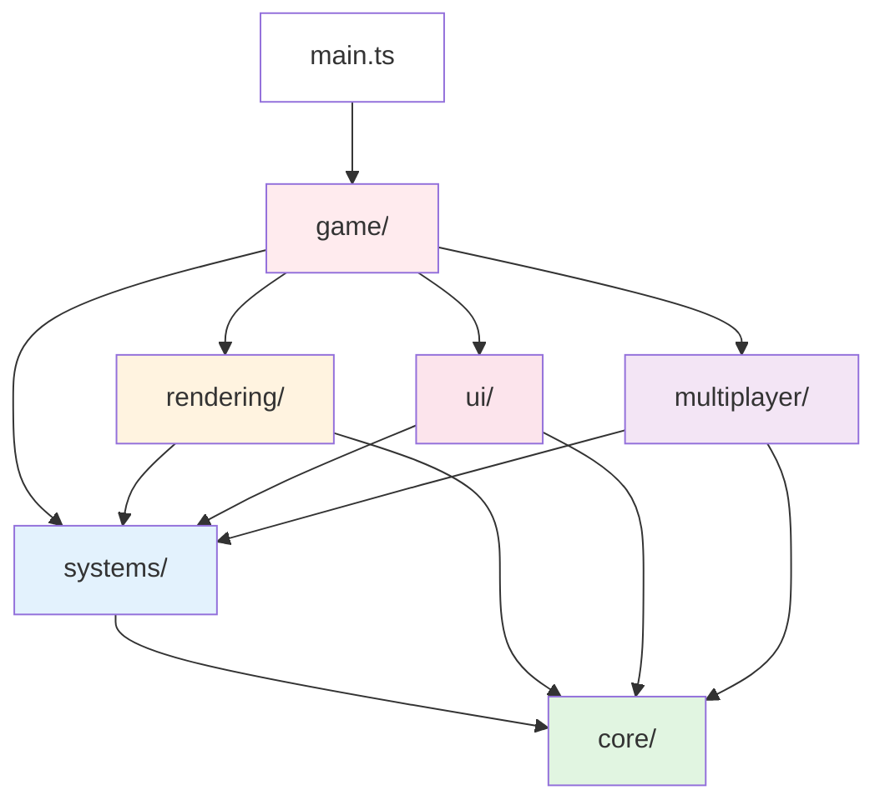

# Project Structure

## Overview

AI Snap uses a modular architecture organized by domain and responsibility. The codebase follows a unidirectional dependency flow where lower-level modules (core utilities) have no dependencies, while higher-level modules (game orchestration) can depend on anything.

## Module Hierarchy

```
src/
├── core/                    # Core infrastructure (no app dependencies)
│   ├── constants/           # Game configuration and constants
│   │   ├── index.ts         # Barrel export
│   │   ├── game-config.ts   # GAME_CONFIG object
│   │   ├── biome-config.ts  # BIOME_COLORS, biome definitions
│   │   └── physics.ts       # TAU, HALF_PI, physics constants
│   ├── utils/               # Utility functions
│   │   ├── index.ts         # Barrel export
│   │   ├── math.ts          # Math utilities, memoization
│   │   ├── pooling.ts       # Object pooling (Vector3, Color)
│   │   └── random.ts        # RNG utilities
│   └── types/               # Shared type definitions
│       ├── index.ts         # Barrel export
│       ├── common.ts        # Common interfaces
│       └── geometry.ts      # Geometry types
│
├── systems/                 # Game systems (depend on core)
│   ├── creatures/           # Creature generation and behavior
│   │   ├── index.ts         # Barrel export
│   │   ├── creature-generator.ts    # Anatomy generation
│   │   ├── creature-builder.ts      # Mesh building
│   │   ├── creature-behavior.ts     # AI behavior patterns
│   │   ├── creature-pool.ts         # Creature pooling
│   │   └── types.ts                 # Creature types
│   ├── terrain/             # Terrain generation
│   │   ├── index.ts         # Barrel export
│   │   ├── TerrainSystem.ts         # Main terrain system
│   │   ├── biome-generator.ts       # Biome generation logic
│   │   └── types.ts                 # Terrain types
│   ├── audio/               # Audio generation and management
│   │   ├── index.ts         # Barrel export
│   │   ├── AudioManager.ts          # Main audio manager
│   │   ├── sound-generator.ts       # Procedural sound generation
│   │   └── types.ts                 # Audio types
│   ├── camera/              # Camera control
│   │   ├── index.ts         # Barrel export
│   │   ├── CameraController.ts      # Camera controller (ride + free roam)
│   │   └── types.ts                 # Camera types
│   ├── photo/               # Photography system
│   │   ├── index.ts         # Barrel export
│   │   ├── PhotoSystem.ts           # Photo capture and scoring
│   │   └── scoring.ts               # Score calculation logic
│   ├── input/               # Input handling
│   │   ├── index.ts         # Barrel export
│   │   ├── InputManager.ts          # Centralized input management
│   │   └── types.ts                 # Input types
│   └── state/               # State management
│       ├── index.ts         # Barrel export
│       ├── state-machine.ts         # State machine implementation
│       ├── state-integration.ts     # Integrated state manager
│       ├── subsystem-state-manager.ts # Subsystem state management
│       ├── subsystem-states.ts      # State definitions
│       └── state-sync-helpers.ts    # State sync utilities
│
├── rendering/               # Rendering systems (depend on core + systems)
│   ├── scene/               # Scene management
│   │   ├── index.ts         # Barrel export
│   │   ├── SceneManager.ts          # 3D scene management
│   │   ├── environment-interactions.ts # Creature-environment interactions
│   │   └── park-structures.ts       # Buildings and landmarks
│   ├── shaders/             # Shader programs
│   │   ├── index.ts         # Barrel export
│   │   ├── ShaderManager.ts         # Shader management
│   │   ├── InscryptionShader.ts     # Inscryption-style shader
│   │   └── types.ts                 # Shader types
│   ├── visual-effects/      # Post-processing effects
│   │   ├── index.ts         # Barrel export
│   │   ├── VisualEffectsManager.ts  # Effects coordinator
│   │   ├── CRTFilter.ts             # CRT simulation
│   │   ├── FilmGrainFilter.ts       # Film grain effect
│   │   └── ChromaticAberrationFilter.ts # Chromatic aberration
│   └── textures/            # Texture management
│       ├── index.ts         # Barrel export
│       └── texture-generator.ts     # Procedural texture generation
│
├── ui/                      # User interface (depends on core + systems)
│   ├── components/          # UI components
│   │   ├── index.ts         # Barrel export
│   │   ├── gallery.ts       # Photo gallery
│   │   ├── settings.ts      # Settings panel
│   │   ├── shortcuts.ts     # Keyboard shortcuts panel
│   │   ├── mini-map.ts      # Mini-map display
│   │   └── toast.ts         # Toast notifications
│   ├── managers/            # UI managers
│   │   ├── index.ts         # Barrel export
│   │   └── UIManager.ts     # Main UI coordinator
│   └── debug/               # Debug UI
│       ├── index.ts         # Barrel export
│       ├── DebugPanel.ts    # Debug panel and performance monitoring
│       └── ShaderDebugUI.ts # Shader debugging interface
│
├── multiplayer/             # Multiplayer systems (depends on core + systems)
│   ├── webrtc/              # WebRTC implementation
│   │   ├── index.ts         # Barrel export
│   │   ├── WebRTCPeer.ts    # WebRTC peer wrapper
│   │   └── ConnectionUI.ts  # Connection UI components
│   ├── state-sync/          # State synchronization
│   │   ├── index.ts         # Barrel export
│   │   └── StateSync.ts     # Binary state synchronization
│   └── peer-avatar/         # Peer rendering
│       ├── index.ts         # Barrel export
│       └── PeerAvatar.ts    # Peer avatar in 3D scene
│
├── game/                    # Game orchestration (can depend on anything)
│   ├── Game.ts              # Main game class
│   ├── GameLoop.ts          # Game loop implementation
│   ├── SystemsCoordinator.ts # System initialization and coordination
│   ├── InputHandler.ts      # High-level input handling
│   └── managers/            # High-level managers
│       ├── index.ts         # Barrel export
│       ├── CreatureManager.ts       # Creature lifecycle management
│       ├── MultiplayerManager.ts    # Multiplayer coordination
│       └── ShaderService.ts         # Shader service coordination
│
└── main.ts                  # Application entry point
```

## Module Dependency Graph



## Module Purposes and Responsibilities

### Core Module (`src/core/`)

**Purpose**: Provides foundational utilities, types, and constants with zero application dependencies.

**Responsibilities**:
- Game configuration constants (GAME_CONFIG, physics constants)
- Math utilities and memoization
- Object pooling for performance-critical objects
- Shared type definitions
- Random number generation utilities

**Dependencies**: None

**Import Path**: `@core/*`

### Systems Module (`src/systems/`)

**Purpose**: Contains domain-specific game systems that implement core functionality.

**Responsibilities**:
- **creatures/**: Procedural creature generation, mesh building, AI behavior, pooling
- **terrain/**: Terrain generation, biome management
- **audio/**: Audio management, procedural sound generation
- **camera/**: Camera control for ride and free roam modes
- **photo/**: Photo capture, scoring, and evaluation
- **input/**: Centralized input handling with action bindings
- **state/**: State machine, subsystem state management, state synchronization

**Dependencies**: `core/`

**Import Path**: `@systems/*`

### Rendering Module (`src/rendering/`)

**Purpose**: Handles all rendering-related functionality including scene management, shaders, and visual effects.

**Responsibilities**:
- **scene/**: 3D scene management, environment interactions, park structures
- **shaders/**: Shader programs and management
- **visual-effects/**: Post-processing effects (CRT, film grain, chromatic aberration)
- **textures/**: Procedural texture generation

**Dependencies**: `core/`, `systems/`

**Import Path**: `@rendering/*`

### UI Module (`src/ui/`)

**Purpose**: Manages all user interface components and interactions.

**Responsibilities**:
- **components/**: Gallery, settings, shortcuts, mini-map, toast notifications
- **managers/**: Main UI coordination
- **debug/**: Debug panel, performance monitoring, shader debugging

**Dependencies**: `core/`, `systems/`

**Import Path**: `@ui/*`

### Multiplayer Module (`src/multiplayer/`)

**Purpose**: Handles peer-to-peer multiplayer functionality.

**Responsibilities**:
- **webrtc/**: WebRTC peer connections and UI
- **state-sync/**: Binary state synchronization between peers
- **peer-avatar/**: Rendering peer avatars in the 3D scene

**Dependencies**: `core/`, `systems/state`

**Import Path**: `@multiplayer/*`

### Game Module (`src/game/`)

**Purpose**: Orchestrates all systems and manages the game loop. This is the highest-level module.

**Responsibilities**:
- Main game class and initialization
- Game loop implementation
- System coordination and lifecycle management
- High-level input handling
- Manager classes that coordinate multiple systems

**Dependencies**: All modules

**Import Path**: `@game/*`

## Architecture Patterns

### Unidirectional Dependencies

The architecture enforces a strict dependency hierarchy:
- **Level 0 (core/)**: No dependencies
- **Level 1 (systems/)**: Depends only on core
- **Level 2 (rendering/, ui/, multiplayer/)**: Depends on core and systems
- **Level 3 (game/)**: Can depend on any module

This prevents circular dependencies and makes the codebase easier to understand and maintain.

### Barrel Exports

Each module uses barrel exports (`index.ts`) to define its public API:

```typescript
// src/systems/creatures/index.ts
export { CreatureManager } from './CreatureManager'
export { generateAnatomy, buildCreature } from './creature-generator'
export type { Anatomy, CreatureInstance, BehaviorState } from './types'
```

This pattern:
- Clearly defines what's public vs internal
- Simplifies imports for consumers
- Makes refactoring easier

### Path Aliases

TypeScript and Vite are configured with path aliases for clean imports:

```typescript
// Instead of: import { GAME_CONFIG } from '../../../core/constants'
import { GAME_CONFIG } from '@core/constants'

// Instead of: import { TerrainSystem } from '../../systems/terrain'
import { TerrainSystem } from '@systems/terrain'
```

### Modular System Design

Each system is self-contained with clear responsibilities. Systems communicate through:
- Public APIs exposed via barrel exports
- Event callbacks (not direct coupling)
- Shared state management (systems/state)

### Object Pooling

Performance-critical objects use pooling to reduce garbage collection:
- Vector3 pooling in `core/utils/pooling.ts`
- Color pooling in `core/utils/pooling.ts`
- Creature pooling in `systems/creatures/creature-pool.ts`

### Configuration-Driven

All magic numbers and configuration values are centralized in `core/constants/`:
- `game-config.ts`: Main game configuration
- `biome-config.ts`: Biome definitions and colors
- `physics.ts`: Physics and math constants

### Procedural Generation

Seeded random number generators ensure deterministic generation:
- Creature anatomy generation
- Terrain and biome generation
- Consistent results for the same seed

## Key Conventions

### File Naming
- **kebab-case** for multi-word files: `creature-generator.ts`, `sound-generator.ts`
- **PascalCase** for single-class files: `CreatureManager.ts`, `AudioManager.ts`
- **index.ts** for barrel exports in every module directory

### Code Naming
- **PascalCase** for classes: `InputManager`, `CameraController`, `TerrainSystem`
- **camelCase** for functions and variables: `generateAnatomy`, `buildCreature`
- **SCREAMING_SNAKE_CASE** for constants: `GAME_CONFIG`, `TAU`, `HALF_PI`

### Exports
- **Named exports only**: No default exports for better refactoring
- **Type exports**: Use `export type` for type-only exports
- **Barrel exports**: Every module has an `index.ts` that re-exports public APIs

### Imports
- **Path aliases**: Always use `@domain/module` format
- **Explicit imports**: Import specific items, not entire modules
- **Type imports**: Use `import type` when importing only types

### Module Organization
- **One responsibility per file**: Each file should have a single, clear purpose
- **Related files grouped**: Use subdirectories for related functionality
- **Public API minimal**: Expose only what's necessary through barrel exports
- **Internal details private**: Keep implementation details within the module

## Migration from Old Structure

The codebase has been restructured from a flat `src/` directory to the modular architecture described above. Key changes:

- **constants.ts** → Split into `core/constants/` (game-config, biome-config, physics)
- **utils.ts** → Split into `core/utils/` (math, pooling, random)
- **creatures.ts** → Refactored into `systems/creatures/` (generator, builder, behavior, pool)
- **terrain-system.ts** → Moved to `systems/terrain/`
- **audio.ts** → Refactored into `systems/audio/`
- **camera.ts** → Moved to `systems/camera/`
- **photo-system.ts** → Refactored into `systems/photo/`
- **input-manager.ts** → Moved to `systems/input/`
- **State files** → Moved to `systems/state/`
- **scene.ts** → Refactored into `rendering/scene/`
- **shaders/** → Moved to `rendering/shaders/`
- **visual-effects/** → Moved to `rendering/visual-effects/`
- **textures.ts** → Moved to `rendering/textures/`
- **ui.ts** → Refactored into `ui/` (components, managers, debug)
- **multiplayer/** → Reorganized into `multiplayer/` (webrtc, state-sync, peer-avatar)

See `docs/migration-guide.md` for detailed migration instructions and import path mappings.
