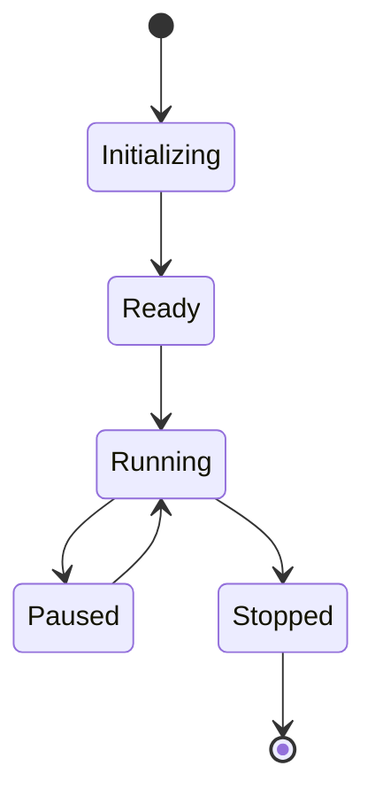

# Game Module

## Overview

The `game` module is the highest-level orchestration layer that coordinates all systems and manages the game loop. It can depend on any other module and is responsible for initializing, updating, and coordinating all game systems.

**Import Path**: `@game/*`

**Dependencies**: All modules (`@core/*`, `@systems/*`, `@rendering/*`, `@ui/*`, `@multiplayer/*`)

## Structure

```
game/
├── Game.ts                  # Main game class
├── GameLoop.ts              # Game loop implementation
├── SystemsCoordinator.ts    # System initialization and coordination
├── InputHandler.ts          # High-level input handling
└── managers/                # High-level managers
    ├── index.ts             # Barrel export
    ├── CreatureManager.ts   # Creature lifecycle management
    ├── MultiplayerManager.ts # Multiplayer coordination
    └── ShaderService.ts     # Shader service coordination
```

## Game Class (`Game.ts`)

The main game class that initializes and coordinates all systems.

### Usage

```typescript
import { Game } from '@game'

// Create and start game
const game = new Game()
game.start()

// Pause/resume
game.pause()
game.resume()

// Stop game
game.stop()
```

### Game Lifecycle



### Game Initialization

```typescript
class Game {
  private scene: SceneManager
  private camera: CameraController
  private renderer: WebGLRenderer
  private systems: SystemsCoordinator
  private gameLoop: GameLoop

  constructor() {
    this.initializeRenderer()
    this.initializeSystems()
    this.initializeGameLoop()
  }

  private initializeRenderer() {
    this.renderer = new WebGLRenderer({ antialias: true })
    this.renderer.setSize(window.innerWidth, window.innerHeight)
    document.body.appendChild(this.renderer.domElement)
  }

  private initializeSystems() {
    this.systems = new SystemsCoordinator()
    this.systems.initialize()
  }

  private initializeGameLoop() {
    this.gameLoop = new GameLoop(this.update.bind(this))
  }

  start() {
    this.gameLoop.start()
  }

  private update(deltaTime: number) {
    this.systems.update(deltaTime)
    this.renderer.render(this.scene.getScene(), this.camera.getCamera())
  }
}
```

## Game Loop (`GameLoop.ts`)

Manages the game loop with fixed timestep and variable rendering.

### Usage

```typescript
import { GameLoop } from '@game'

const gameLoop = new GameLoop((deltaTime) => {
  // Update game logic
  updatePhysics(deltaTime)
  updateSystems(deltaTime)
})

gameLoop.start()
```

### Fixed Timestep

Uses a fixed timestep for consistent physics:

```typescript
class GameLoop {
  private readonly FIXED_TIMESTEP = 1 / 60 // 60 FPS
  private accumulator = 0
  private lastTime = 0

  private loop(currentTime: number) {
    const deltaTime = (currentTime - this.lastTime) / 1000
    this.lastTime = currentTime

    this.accumulator += deltaTime

    // Fixed timestep updates
    while (this.accumulator >= this.FIXED_TIMESTEP) {
      this.updateCallback(this.FIXED_TIMESTEP)
      this.accumulator -= this.FIXED_TIMESTEP
    }

    // Variable rendering
    this.renderCallback()

    requestAnimationFrame(this.loop.bind(this))
  }
}
```

### Performance Monitoring

```typescript
class GameLoop {
  private fps = 0
  private frameCount = 0
  private lastFpsUpdate = 0

  private updateFPS(currentTime: number) {
    this.frameCount++

    if (currentTime - this.lastFpsUpdate >= 1000) {
      this.fps = this.frameCount
      this.frameCount = 0
      this.lastFpsUpdate = currentTime
    }
  }

  getFPS(): number {
    return this.fps
  }
}
```

## Systems Coordinator (`SystemsCoordinator.ts`)

Initializes and coordinates all game systems.

### Usage

```typescript
import { SystemsCoordinator } from '@game'

const coordinator = new SystemsCoordinator()

// Initialize all systems
coordinator.initialize()

// Update all systems
coordinator.update(deltaTime)

// Get specific system
const camera = coordinator.getSystem('camera')
```

### System Initialization Order

Systems are initialized in dependency order:

```typescript
class SystemsCoordinator {
  initialize() {
    // 1. Core systems (no dependencies)
    this.input = new InputManager()
    this.audio = new AudioManager()

    // 2. Scene and rendering
    this.scene = new SceneManager()
    this.renderer = this.initializeRenderer()

    // 3. Game systems
    this.terrain = new TerrainSystem(this.scene, seed)
    this.camera = new CameraController(this.renderer.camera)
    this.creatures = new CreatureManager(this.scene, this.terrain)

    // 4. UI systems
    this.ui = new UIManager()
    this.debug = new DebugPanel()

    // 5. Multiplayer (optional)
    if (multiplayerEnabled) {
      this.multiplayer = new MultiplayerManager()
    }
  }
}
```

### System Update Order

Systems are updated in the correct order:

```typescript
class SystemsCoordinator {
  update(deltaTime: number) {
    // 1. Input (first, to capture user input)
    this.input.update()

    // 2. Game logic
    this.camera.update(deltaTime)
    this.creatures.update(deltaTime)
    this.terrain.update(deltaTime)

    // 3. Physics and interactions
    this.scene.updateInteractions(deltaTime)

    // 4. Multiplayer sync
    if (this.multiplayer) {
      this.multiplayer.update(deltaTime)
    }

    // 5. UI (last, to reflect current state)
    this.ui.update(deltaTime)
    this.debug.update(deltaTime)
  }
}
```

## Input Handler (`InputHandler.ts`)

High-level input handling that translates input actions to game commands.

### Usage

```typescript
import { InputHandler } from '@game'

const inputHandler = new InputHandler(inputManager, camera, photoSystem)

// Update input handling
inputHandler.update(deltaTime)

// Enable/disable input contexts
inputHandler.enableContext('game')
inputHandler.disableContext('ui')
```

### Input Contexts

Different input contexts for different game states:

```typescript
class InputHandler {
  private contexts = {
    game: this.handleGameInput.bind(this),
    ui: this.handleUIInput.bind(this),
    menu: this.handleMenuInput.bind(this)
  }

  private handleGameInput(deltaTime: number) {
    // Camera movement
    if (this.input.isActionActive('move-forward')) {
      this.camera.moveForward(deltaTime)
    }

    // Photo capture
    if (this.input.isActionPressed('capture-photo')) {
      this.photoSystem.capturePhoto()
    }

    // Toggle camera mode
    if (this.input.isActionPressed('toggle-camera-mode')) {
      this.camera.toggleMode()
    }
  }

  private handleUIInput(deltaTime: number) {
    // UI navigation
    if (this.input.isActionPressed('ui-up')) {
      this.ui.navigateUp()
    }
  }
}
```

## Managers (`@game/managers`)

High-level managers that coordinate multiple systems.

### Creature Manager

Manages creature lifecycle and spawning.

```typescript
import { CreatureManager } from '@game/managers'

const creatureManager = new CreatureManager(scene, terrain)

// Spawn creatures
creatureManager.spawnCreatures(count)

// Update creatures
creatureManager.update(deltaTime)

// Get creatures in view
const visibleCreatures = creatureManager.getCreaturesInView(camera)
```

### Multiplayer Manager

Coordinates multiplayer functionality.

```typescript
import { MultiplayerManager } from '@game/managers'

const multiplayerManager = new MultiplayerManager()

// Host session
multiplayerManager.hostSession()

// Join session
multiplayerManager.joinSession(offer)

// Update multiplayer
multiplayerManager.update(deltaTime)
```

### Shader Service

Coordinates shader management across systems.

```typescript
import { ShaderService } from '@game/managers'

const shaderService = new ShaderService(renderer, scene, camera)

// Apply shader preset
shaderService.applyPreset('retro')

// Update shaders
shaderService.update(deltaTime)
```

## Best Practices

### Initialization Order

Always initialize systems in dependency order:

```typescript
// ✅ Good: Correct order
const scene = new SceneManager()
const terrain = new TerrainSystem(scene) // Depends on scene
const creatures = new CreatureManager(scene, terrain) // Depends on both

// ❌ Bad: Wrong order
const creatures = new CreatureManager(scene, terrain) // terrain not initialized yet!
const terrain = new TerrainSystem(scene)
```

### Update Order

Update systems in logical order:

```typescript
// ✅ Good: Logical order
input.update()      // 1. Capture input
physics.update()    // 2. Update physics
creatures.update()  // 3. Update creatures
ui.update()         // 4. Update UI

// ❌ Bad: Wrong order
ui.update()         // UI updates before game state!
creatures.update()
physics.update()
input.update()
```

### Error Handling

Handle system initialization errors:

```typescript
class SystemsCoordinator {
  initialize() {
    try {
      this.initializeCore()
      this.initializeGame()
      this.initializeUI()
    } catch (error) {
      console.error('System initialization failed:', error)
      this.showErrorScreen(error)
      throw error
    }
  }
}
```

### Resource Cleanup

Clean up resources on shutdown:

```typescript
class Game {
  stop() {
    // Stop game loop
    this.gameLoop.stop()

    // Dispose systems
    this.systems.dispose()

    // Clean up renderer
    this.renderer.dispose()

    // Remove DOM elements
    this.renderer.domElement.remove()
  }
}
```

## Performance Optimization

### System Updates

Only update systems that need updating:

```typescript
class SystemsCoordinator {
  update(deltaTime: number) {
    // Always update
    this.input.update()
    this.camera.update(deltaTime)

    // Conditional updates
    if (this.creatures.needsUpdate()) {
      this.creatures.update(deltaTime)
    }

    if (this.multiplayer?.isConnected()) {
      this.multiplayer.update(deltaTime)
    }
  }
}
```

### Lazy Initialization

Initialize expensive systems only when needed:

```typescript
class SystemsCoordinator {
  private _multiplayer: MultiplayerManager | null = null

  get multiplayer(): MultiplayerManager {
    if (!this._multiplayer) {
      this._multiplayer = new MultiplayerManager()
    }
    return this._multiplayer
  }
}
```

### Frame Budget

Distribute expensive operations across frames:

```typescript
class CreatureManager {
  private updateIndex = 0

  update(deltaTime: number) {
    // Update only a subset of creatures per frame
    const batchSize = 10
    const start = this.updateIndex
    const end = Math.min(start + batchSize, this.creatures.length)

    for (let i = start; i < end; i++) {
      this.creatures[i].update(deltaTime)
    }

    this.updateIndex = (end >= this.creatures.length) ? 0 : end
  }
}
```

## Testing

### Unit Testing

Test individual systems:

```typescript
describe('Game', () => {
  it('should initialize all systems', () => {
    const game = new Game()
    expect(game.systems).toBeDefined()
    expect(game.gameLoop).toBeDefined()
  })

  it('should start and stop correctly', () => {
    const game = new Game()
    game.start()
    expect(game.isRunning()).toBe(true)
    
    game.stop()
    expect(game.isRunning()).toBe(false)
  })
})
```

### Integration Testing

Test system interactions:

```typescript
describe('SystemsCoordinator', () => {
  it('should initialize systems in correct order', () => {
    const coordinator = new SystemsCoordinator()
    const initOrder: string[] = []

    // Mock systems to track initialization
    coordinator.onSystemInit = (name) => initOrder.push(name)

    coordinator.initialize()

    expect(initOrder).toEqual([
      'input',
      'audio',
      'scene',
      'terrain',
      'camera',
      'creatures',
      'ui'
    ])
  })
})
```

## Common Patterns

### State Machine

Use state machine for game states:

```typescript
class Game {
  private state: 'menu' | 'playing' | 'paused' | 'gameover' = 'menu'

  setState(newState: typeof this.state) {
    this.onStateExit(this.state)
    this.state = newState
    this.onStateEnter(newState)
  }

  private onStateEnter(state: typeof this.state) {
    switch (state) {
      case 'playing':
        this.gameLoop.start()
        break
      case 'paused':
        this.gameLoop.pause()
        break
    }
  }
}
```

### Event System

Use events for system communication:

```typescript
class Game extends EventEmitter {
  start() {
    this.emit('game:start')
    this.gameLoop.start()
  }

  stop() {
    this.emit('game:stop')
    this.gameLoop.stop()
  }
}

// Listen for events
game.on('game:start', () => {
  console.log('Game started!')
})
```
