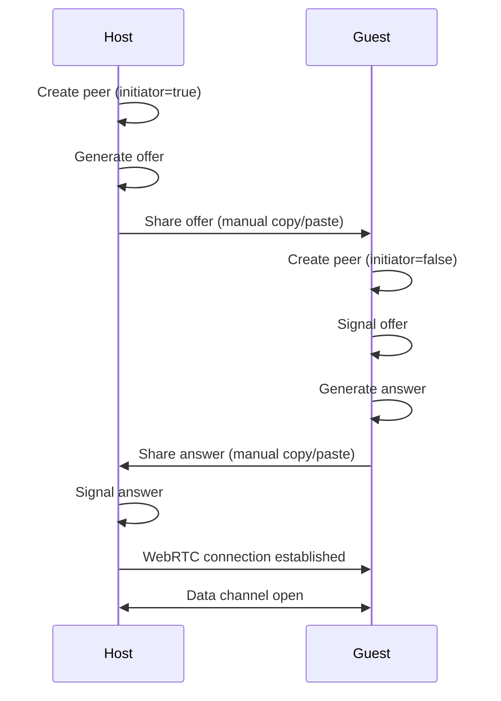

# Multiplayer Module

## Overview

The `multiplayer` module handles peer-to-peer multiplayer functionality using WebRTC. It enables serverless real-time connections between players without requiring dedicated servers, making it perfect for static hosting.

**Import Path**: `@multiplayer/*`

**Dependencies**: `@core/*`, `@systems/state`

## Structure

```
multiplayer/
├── webrtc/          # WebRTC implementation
├── state-sync/      # State synchronization
└── peer-avatar/     # Peer rendering
```

## WebRTC System (`@multiplayer/webrtc`)

Manages WebRTC peer connections and signaling.

### Key Components

- **WebRTCPeer.ts**: WebRTC peer connection wrapper
- **ConnectionUI.ts**: Connection UI components

### Usage

```typescript
import { WebRTCPeer } from '@multiplayer/webrtc'

// Create peer (host)
const peer = new WebRTCPeer(true) // true = initiator

// Generate offer
peer.on('signal', (data) => {
  const offer = JSON.stringify(data)
  // Share offer with guest
})

// Receive answer
peer.signal(answerData)

// Connection established
peer.on('connect', () => {
  console.log('Connected!')
})

// Receive data
peer.on('data', (data) => {
  console.log('Received:', data)
})

// Send data
peer.send({ type: 'position', x: 10, y: 20, z: 30 })
```

### WebRTC Connection Flow



### Connection UI

```typescript
import { ConnectionUI } from '@multiplayer/webrtc'

const connectionUI = new ConnectionUI()

// Show connection dialog
connectionUI.showHostDialog((offer) => {
  // Host generated offer
  console.log('Share this offer:', offer)
})

connectionUI.showGuestDialog((answer) => {
  // Guest generated answer
  console.log('Share this answer:', answer)
})

// Connection status
connectionUI.updateStatus('connecting')
connectionUI.updateStatus('connected')
connectionUI.updateStatus('disconnected')
```

## State Sync System (`@multiplayer/state-sync`)

Synchronizes game state between peers using efficient binary encoding.

### Key Components

- **StateSync.ts**: Binary state synchronization

### Usage

```typescript
import { StateSync } from '@multiplayer/state-sync'

const stateSync = new StateSync(peer)

// Send state update
stateSync.sendState({
  position: { x: 10, y: 20, z: 30 },
  rotation: { x: 0, y: 1.5, z: 0 },
  cameraMode: 'ride'
})

// Receive state updates
stateSync.on('state', (state) => {
  console.log('Peer state:', state)
  updatePeerAvatar(state)
})
```

### State Encoding

StateSync uses binary encoding for efficient bandwidth usage:

```typescript
// State structure (binary format)
// Position: 3 floats (12 bytes)
// Rotation: 3 floats (12 bytes)
// Camera mode: 1 byte
// Total: 25 bytes per update

// Sent at 10 Hz = ~250 bytes/sec = ~2 Kbps
```

### Bandwidth Optimization

- **Binary encoding**: More efficient than JSON
- **Delta compression**: Only send changed values
- **Update throttling**: Limit update frequency
- **Interpolation**: Smooth movement between updates

```typescript
// Throttle updates to 10 Hz
const UPDATE_INTERVAL = 100 // ms

let lastUpdate = 0
function update(time: number) {
  if (time - lastUpdate > UPDATE_INTERVAL) {
    stateSync.sendState(getCurrentState())
    lastUpdate = time
  }
}
```

## Peer Avatar System (`@multiplayer/peer-avatar`)

Renders peer players in the 3D scene.

### Key Components

- **PeerAvatar.ts**: Peer avatar rendering

### Usage

```typescript
import { PeerAvatar } from '@multiplayer/peer-avatar'

const peerAvatar = new PeerAvatar(scene)

// Update peer position
peerAvatar.updatePosition(x, y, z)
peerAvatar.updateRotation(x, y, z)

// Update camera indicator
peerAvatar.updateCameraDirection(direction)

// Show/hide avatar
peerAvatar.show()
peerAvatar.hide()

// Remove avatar
peerAvatar.dispose()
```

### Avatar Features

- **Position indicator**: Shows peer location in 3D space
- **Camera direction**: Visual indicator of where peer is looking
- **Smooth interpolation**: Smooth movement between updates
- **Name label**: Optional name display above avatar

### Interpolation

Smooth peer movement using interpolation:

```typescript
class PeerAvatar {
  private targetPosition: Vector3
  private currentPosition: Vector3

  updatePosition(x: number, y: number, z: number) {
    this.targetPosition.set(x, y, z)
  }

  update(deltaTime: number) {
    // Lerp to target position
    this.currentPosition.lerp(this.targetPosition, 0.1)
    this.mesh.position.copy(this.currentPosition)
  }
}
```

## Best Practices

### Connection Management

Handle connection lifecycle properly:

```typescript
class MultiplayerManager {
  private peer: WebRTCPeer | null = null

  connect(isHost: boolean) {
    this.peer = new WebRTCPeer(isHost)

    this.peer.on('connect', () => {
      this.onConnected()
    })

    this.peer.on('close', () => {
      this.onDisconnected()
    })

    this.peer.on('error', (err) => {
      this.onError(err)
    })
  }

  disconnect() {
    if (this.peer) {
      this.peer.destroy()
      this.peer = null
    }
  }
}
```

### Error Handling

Handle connection errors gracefully:

```typescript
peer.on('error', (err) => {
  console.error('Connection error:', err)
  
  // Show user-friendly message
  ui.showToast('Connection failed. Please try again.', 'error')
  
  // Clean up
  this.disconnect()
})
```

### State Synchronization

Synchronize only necessary state:

```typescript
// ✅ Good: Only essential state
const state = {
  position: player.position,
  rotation: player.rotation,
  cameraMode: camera.mode
}

// ❌ Bad: Too much data
const state = {
  position: player.position,
  rotation: player.rotation,
  velocity: player.velocity,
  acceleration: player.acceleration,
  allCreatures: creatures.map(c => c.toJSON()),
  terrain: terrain.toJSON()
}
```

### Update Frequency

Balance update frequency with bandwidth:

```typescript
// Position updates: 10 Hz (smooth movement)
const POSITION_UPDATE_HZ = 10

// Camera updates: 5 Hz (less critical)
const CAMERA_UPDATE_HZ = 5

// Photo notifications: Event-based (only when needed)
peer.on('photo-taken', (photo) => {
  ui.showToast(`${peerName} took a photo!`, 'info')
})
```

### Latency Compensation

Compensate for network latency:

```typescript
class PeerAvatar {
  private latency: number = 0

  updateLatency(ping: number) {
    this.latency = ping / 2 // One-way latency
  }

  predictPosition(position: Vector3, velocity: Vector3): Vector3 {
    // Predict position based on latency
    const predicted = position.clone()
    predicted.addScaledVector(velocity, this.latency / 1000)
    return predicted
  }
}
```

## Advanced Features

### Voice Chat

Add voice chat using WebRTC audio:

```typescript
// Get user media
const stream = await navigator.mediaDevices.getUserMedia({ audio: true })

// Add audio track to peer connection
stream.getAudioTracks().forEach(track => {
  peer.addTrack(track, stream)
})

// Receive audio
peer.on('stream', (remoteStream) => {
  const audio = new Audio()
  audio.srcObject = remoteStream
  audio.play()
})
```

### Data Channels

Use multiple data channels for different data types:

```typescript
// Reliable channel for important data
const reliableChannel = peer.createDataChannel('reliable', {
  ordered: true,
  maxRetransmits: 3
})

// Unreliable channel for position updates
const unreliableChannel = peer.createDataChannel('unreliable', {
  ordered: false,
  maxRetransmits: 0
})
```

### Peer Discovery

Implement peer discovery using a signaling server:

```typescript
// Connect to signaling server
const ws = new WebSocket('wss://signaling.example.com')

// Register as available peer
ws.send(JSON.stringify({
  type: 'register',
  id: myPeerId
}))

// Discover peers
ws.send(JSON.stringify({
  type: 'discover'
}))

// Receive peer list
ws.onmessage = (event) => {
  const data = JSON.parse(event.data)
  if (data.type === 'peers') {
    console.log('Available peers:', data.peers)
  }
}
```

## Troubleshooting

### Connection Fails

Common causes and solutions:

1. **Firewall/NAT issues**: Use STUN/TURN servers
2. **Invalid offer/answer**: Ensure complete copy/paste
3. **Browser compatibility**: Use Chrome/Edge for best support

```typescript
// Configure STUN servers
const peer = new WebRTCPeer(true, {
  config: {
    iceServers: [
      { urls: 'stun:stun.l.google.com:19302' },
      { urls: 'stun:stun1.l.google.com:19302' }
    ]
  }
})
```

### High Latency

Reduce latency:

1. **Optimize state size**: Send less data
2. **Increase update frequency**: More frequent updates
3. **Use prediction**: Predict peer position
4. **Use unreliable channel**: For position updates

### Desynchronization

Prevent state desynchronization:

1. **Timestamp updates**: Include timestamp in state
2. **Periodic full sync**: Send full state periodically
3. **Acknowledge updates**: Confirm receipt of important updates

```typescript
// Periodic full sync
setInterval(() => {
  stateSync.sendFullState(getFullState())
}, 5000) // Every 5 seconds
```

## Testing Multiplayer

### Local Testing

Test multiplayer locally:

1. Open two browser windows
2. Create session in first window (host)
3. Join session in second window (guest)
4. Test connection and state sync

### Network Simulation

Simulate network conditions:

```typescript
// Simulate latency
function simulateLatency(data: any, delay: number) {
  setTimeout(() => {
    peer.send(data)
  }, delay)
}

// Simulate packet loss
function simulatePacketLoss(data: any, lossRate: number) {
  if (Math.random() > lossRate) {
    peer.send(data)
  }
}
```

### Debugging

Enable debug logging:

```typescript
peer.on('signal', (data) => {
  console.log('Signal:', data)
})

peer.on('data', (data) => {
  console.log('Received:', data)
})

peer.on('connect', () => {
  console.log('Connected')
})
```
